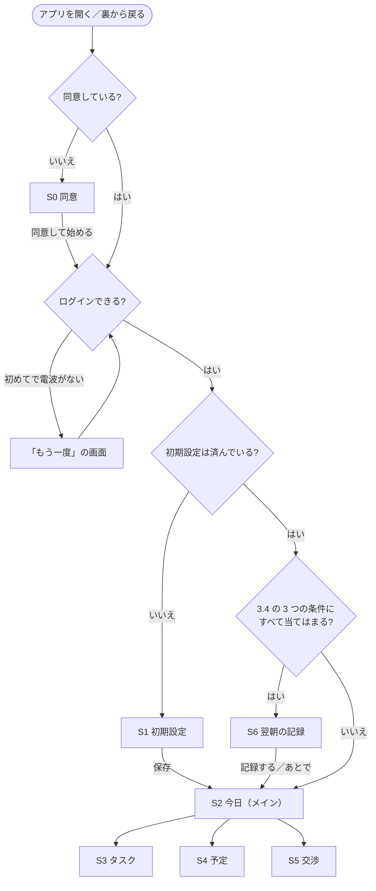

# Rism ベータ版 開発仕様書

- **版:** v3（2026-11-11・下書き）
- **共有範囲:** プロジェクトメンバー向け（特に開発メンバー）
- **この仕様書の「ベータ」:** 12 月に京大マーケの部員に使ってもらう**プライベートベータ**のことです。
- **元にした資料:** `docs/alpha_spec.md`（v17）、アルファのふりかえり、リポジトリの今の状態（`main` と PR #42、11/11 時点）
- **体制:** 開発 FT・IH・IK ／ マーケティング MH ／ 開発責任者（進行役）ぷらぐら（オーナー） ／ 技術の相談役 FT
- **読み方:** 全員 1・2・8 章、開発メンバーは 3〜7 章のうち自分の担当部分を読んでください。
- 「**【仮決め】**」は、オーナーが変えない限りこのまま進めてよい決め事です。「**開発者の判断でよい**」は、聞かずに決めて構いません。「**【要相談】**」は、決まるまで手を付けないでください。

---

## 0. アルファの仕様書との関係

アルファの仕様書（`docs/alpha_spec.md`）は、**下の表で「置き換え」とした所以外は、そのまま使います**（起床・限界時刻の計算、タスク、タイムラインの作り方、交渉の決め事など）。

| アルファの仕様書 | ベータでの扱い |
| --- | --- |
| 1.1 完成の条件、1.2 やらないこと | この仕様書の 1 章に置き換え |
| 3.6 のうち「AI の呼び出し方（アルファ）」（キーを `dart_defines.json` に置く、アプリから Gemini を直接呼ぶ） | この仕様書の 3.6 に置き換え。案のチェック・延長の計算・予備の案などの決め事はそのまま |
| 3.7 保存（端末内に保存） | この仕様書の 3.3 に置き換え。日付が変わったときの直し方（午前 4:00）はそのまま |
| 4 章 データの形 | そのまま使う。ただし「交渉の記録 Negotiation」は、この仕様書 5 章の「その晩の控え」に置き換え。ほかに 5 章のデータを足す |
| 5 章 技術の決め事（Chrome で動かす） | この仕様書の 7 章に置き換え。Git の決め事（5.1）はそのまま |
| 6 章 担当、8 章 Issue の一覧 | この仕様書の 3 章・7.1 と、GitHub の Issue に置き換え。Issue・PR の番号の書き方（8.1）、毎日の 1 行報告（8.2）はそのまま |

---

## 1. ベータ版で確かめたいこと

> 京大マーケの部員（テスター）が、**説明なしで使い始めて、3 週間ふつうに使い続けられる**こと。そして「**就寝時刻が早くなったか**」を確かめられる記録が集まること。

アルファは「1 台のパソコンの Chrome で動けば成功」でした。ベータは**テスターのスマホで毎日使われる**ので、機能の数より「止まらない・消えない・迷わない」を大事にします。

### 1.1 ベータと呼べる条件

| # | 条件 | 確かめる日 |
| --- | --- | --- |
| 1 | 一連の流れが途切れずに使える：同意 → 初期設定 → 予定・タスク入力 → タイムライン → AI で調整 → 限界時刻の通知 → 翌朝の記録 | 11/22（機能がそろったか） |
| 2 | 3 週間毎日使っても、入力したデータや記録が消えない | 11/22（作りの確認）、11/28（メンバー内テスト） |
| 3 | 開発メンバーが横で説明しなくても、テスターが使い始められる（短い使い方ガイドつき） | 11/28 |
| 4 | iPhone・Android の両方で、メンバー内テストで致命的な不具合が出ていない | 11/28 |
| 5 | 集めた記録を、マーケティング担当が集計できる形で取り出せる | 11/28 |

- **11/22（日）：** 機能がそろったかを確かめ、これ以降は新しい機能を足さない（機能追加の締め切り）。
- **11/28（土）ごろ：** 5 つすべてを確かめ、オーナーが **11/30 に配るか、12/7 にずらすか**を決める。

### 1.2 完成の条件（メンバー内テストで、実機の iPhone・Android で次が動くこと）

| # | 操作 | 期待する結果 |
| --- | --- | --- |
| 1 | 配られたアプリを入れて、初めて開く | 同意画面（S0）が出る。同意しないと先に進めない |
| 2 | 同意する | 名前やメールアドレスを入れずに使い始められ（匿名ログイン）、初期設定（S1）が出る |
| 3 | 初期設定・予定・タスクを入れる | アルファと同じように、限界時刻とタイムラインが出る |
| 4 | タスクを消す、今日・明日の予定を直す・消す | タイムラインと限界時刻が作り直される（明日の予定を消すと、限界時刻が変わる） |
| 5 | 「あと少し起きていたい」→ 案を選ぶ | アルファと同じように反映される。AI の呼び出しは、アプリに API キーを置かずに動く |
| 6 | アプリを閉じて待つ | 限界時刻の前と、限界時刻に通知が届く |
| 7 | 次の朝（午前 4:00 以降）に開く（裏に残っていたアプリに戻った場合も） | 翌朝の記録（S6）が出て、寝た時刻・起きた時刻・目覚めを記録できる |
| 8 | 機内モードにして使い、あとで電波を戻す | 使っている間も止まらず、電波が戻るとデータがクラウドに保存される（初めて開くときを除く） |
| 9 | アプリを閉じて、次の日にまた開く | 入れたデータと記録が残っている |

### 1.3 ベータでやらないこと

Google・Apple でのログイン、課金、外部カレンダー連携、スマホいじり検知、長期のタスク管理、Web 版の公開、夜モード、デザインの作り込み、アプリが落ちたことを知らせる仕組み（Crashlytics）。

**配布のあと（12 月以降）に検討：** 「毎日のタスク」と「何時まで」（夕食・風呂を明日に回さない、買い物を深夜に置かない）、AI によるタスクの種類の提案。

---

## 2. 日程

| 時期 | 開発 | マーケティング・オーナー |
| --- | --- | --- |
| 11/9（月）〜11/15 | 準備（AI 向けの指示書の書き換え、PR #42 のマージ、アプリの ID、Firebase の導入とパッケージの追加）、クラウド保存、AI 呼び出しの移し替え、同意画面 | 測るもの（6.1）の案（**11/13 まで**）、同意書・プライバシーポリシーの下書き（オーナー） |
| 11/16〜11/22 | 翌朝の記録、通知、タスク・予定の削除、**メンバーへの最初の配布（11/18 ごろ）**、できれば機能。**11/22（日）機能追加の締め切り** | テスター募集、同意書・プライバシーポリシーの確定（**11/20 まで**） |
| 11/23〜11/29 | メンバー内テスト（実機）・不具合の修正、**iPhone 版の審査に提出（11/25 まで）**、記録の取り出し | 使い方ガイド、テスターの「使う前」の就寝時刻の記録、**配るかを決める（11/28 ごろ）** |
| **11/30（月）** | **ベータ配布** | ← |
| 12 月 | 不具合対応 | 部内テスト・データ集め |

**早めにメンバーへ一度配る（11/18 ごろ）：** 機能がそろっていなくても、メンバーのスマホに一度入れてみます。配布の手続きでつまずく所を、締め切りの前に見つけるためです。**Apple の登録がそれまでに済めば、iPhone（TestFlight）と Android（Firebase App Distribution）を同時に配ります。間に合わなければ、Android を先に配ります。**

---

## 3. 作るもの

### 3.1 一覧

**準備**（1 週目に先に済ませる。ほかの作業の前提になる）

| # | 内容 | 担当【仮決め】 | 章 |
| --- | --- | --- | --- |
| P1 | AI 向けの指示書（`CLAUDE.md`・`AGENTS.md`）と `README.md` をベータ用にする、この仕様書を `docs/beta_spec.md` に置く、片付け | オーナー | 8.2 |
| P2 | アプリの ID とバージョンを変える | FT | 3.7 |
| P3 | Firebase の導入、パッケージ・`.gitignore`・`firebase.json` をまとめて用意 | FT | 3.3、7 |
| P4 | 開発用に「今の時刻」を決められるようにする | FT | 3.13 |

**必須**（1.1 の条件に必要なもの）

| # | 内容 | 担当【仮決め】 | 章 |
| --- | --- | --- | --- |
| B1 | アルファの直し（PR #42 のマージ、限界時刻を過ぎたあとの交渉、片付け） | レビュー FT ／ 交渉 IH ／ 片付け IK | 3.2 |
| B2 | 匿名ログイン＋クラウド保存 | FT | 3.3 |
| B3 | 翌朝の記録（S6） | 保存 FT ／ 画面 IK ／ 振り分けと S2 の表示 IH | 3.4 |
| B4 | 限界時刻の通知 | IH | 3.5 |
| B5 | AI の API キーをアプリに置かない（Cloud Functions 経由） | IH | 3.6 |
| B6 | iPhone・Android で配布 | iPhone FT ／ Android IH | 3.7 |
| B7 | 同意画面（S0）とプライバシーポリシー | 文面 オーナー（技術の部分の確認 IH）／ 同意の記録 FT ／ 画面 IK ／ 起動の流れと公開 IH | 3.8 |
| B8 | 記録の取り出しと、データを消す道具 | IH | 3.9 |
| B9 | タスクの削除、今日・明日の予定の編集・削除 | 処理 FT ／ S3・S4 IK ／ S2 IH | 3.10 |

**できれば**（必須が遅れていたら後回し）

| # | 内容 | 担当【仮決め】 | 章 |
| --- | --- | --- | --- |
| C1 | 自由時間をタイムラインに出す | 計算 FT ／ 表示と理由 IH | 3.11 |
| C2 | 「延長だけ」の案をアプリが足す | IH | 3.12 |

**担当の最新は、GitHub の Issue の「Assignees」を正とします**（アルファと同じ）。

### 3.2 B1 アルファの直し

- **交渉の「空く時間」の数えすぎ：** PR #42（IH）で直し済み。**FT がレビューしてマージし、Issue #13 を閉じる。**
- **限界時刻を過ぎたあとの交渉（決定）：** 限界時刻を過ぎたら、「あと少し起きていたい」を**押せないようにする**（IH）。睡眠を守るアプリなので、限界時刻のあとに延長を勧めないため。
  - タイムラインはアルファの 3.1 のとおり空にして、「限界時刻を過ぎています。今寝れば ○ 時間 ○ 分眠れます」と出す。「明日に回す」「完了したタスク」「明日の予定」の一覧と、＋タスク・＋予定のボタンは、そのまま出す。
  - S5 を開いている間に限界時刻を過ぎた場合は、案を選んでも反映せず、S5 を閉じて上のメッセージを出す。
- **片付け（IK。最初の PR の練習として）：** `lib/screens/placeholder_screen.dart`・`s3_demo_main.dart`・`s4_demo_main.dart` を消す。`ai_proto_main.dart`・`s5_demo_main.dart`・`negotiation_samples.dart` は B5 で消す（IH）。
- アルファの仕様書 1.1 #7 の書き方は、オーナーが直す（v18）。

### 3.3 B2 匿名ログイン＋クラウド保存

**Firebase の導入（P3・FT）**

- `flutterfire configure --project=rism-85e9d` で iOS・Android・Web を設定する。できたファイルはリポジトリに入れる（7 章）。終わったらオーナーに知らせる。
- `lib/main.dart` に Firebase の初期化を入れる。**IH が `main.dart` の作業を始める前に入れる。**
- `firebase.json` には、Firestore・Functions（`functions/`）・Hosting（`hosting/public/`）の 3 つの設定を最初から書く。`.firebaserc` は `rism-85e9d`。
- `.gitignore` に、ベータで要る項目をまとめて足す：`functions/node_modules/`・`functions/lib/`・`functions/.secret.local`・`android/key.properties`・`*.jks`・`*.keystore`・`*.csv`。
- 自動テストでは Firebase を初期化しない。

**ログイン（B2・FT、新しく `lib/auth.dart`）**

- **Firebase Authentication の匿名ログイン**を使う。名前・メールアドレス・パスワードは聞かない。
- 「ログイン済みならそのまま、まだなら匿名ログインする」関数を作る。電波がなくてログインできないときは、それとわかる失敗を返す。テスター ID（ユーザー ID の先頭 6 文字など。**開発者の判断でよい**）も返す。
- **本物の版と、テスト用に差し替える版を作る。**
- 同意（S0）のあとにログインする。同意の前にはデータを送らない。
- **初めてのログインには電波が要る。** 2 回目以降に開くときは、電波がなくても使える。

**保存（B2・FT）**

- **Cloud Firestore** に保存する。
- 新しく `lib/storage_backend.dart` に保存先の形を作る。**キーだけでなく、場所（パス）で読む・書く・消すができる形**にする。本物は Firestore 版（`users/{ユーザーの ID}/` の下に書く）、テストではメモリの中に保存する版を使う。
- `lib/storage.dart` の公開している関数の形はそのままにし、中で `SharedPreferences` を使っている `_saveJson`・`_loadJson`・`clearAll` を保存先経由にする。新しいデータ（5 章）の関数は足す。
- **今の自動テストを生かす：** `storage_test`・`today_controller_test`・`widget_test`・`negotiation_context_test` の `setUp` をメモリ版に変え、`flutter test` と GitHub の自動チェックが通るようにする。
- **書き込みは、サーバーの返事を待たない。** Firestore はオフラインのとき、書き込みが端末にはすぐ入るが、サーバーに届くまで終わらない。待つと、電波がないときに画面が止まるため。読み込みの仕方（端末の控えを先に読むかなど）は**開発者の判断でよい**。
- アルファで端末に保存したデータは、引き継がなくてよい。

**セキュリティルール（FT）**

- `firestore.rules` をリポジトリに置き、**FT が `firebase deploy --only firestore:rules` でデプロイする**。変えるときは必ず PR にして FT が確認する。
- `users/{ユーザーの ID}/` の下は**本人だけ**が読み書きできる。それ以外は全部断る。
- Firestore は「本番環境モード」で作ってあるので、ルールをデプロイするまでアプリからは何も読み書きできない。

**注意（テスターに伝える）：** 匿名ログインなので、アプリを消すとデータも記録も戻せない。使い方ガイドに「テスト中はアプリを消さないでください」と書く。

### 3.4 B3 翌朝の記録（S6）

**いつ出すか**

次の 3 つがすべて当てはまるとき、S2 より先に S6 を出す（初期設定がまだのときは S1 が先）。

1. 前の晩の記録がまだない
2. 前の晩が、**同意した晩以降**である（使い始める前の晩の記録は求めない）
3. **その日（午前 4:00 区切り）に、まだ S6 を出していない**（「あとで」を押したら、その日はもう出さない）

- 判定するのは、アプリを開いたときと、**裏に残っていたアプリが前に戻ったとき**（IH、`main.dart`・`today_screen.dart`）。スマホでは裏から戻るのがふつうなので。
- 前の晩にアプリを開かなかった場合も、上の条件に合えば出す。
- 「あとで」を押したときと、その日に記録していないときは、S2 の上部に「昨日の記録がまだです」と出し、押すと S6 を開く。

**入れるもの【仮決め・6.1 で MH の案を見て足す】**

| 項目 | 入れ方 | 初期値 |
| --- | --- | --- |
| 寝た時刻 | 時刻を選ぶ（5 分単位） | 前の晩の控え（5 章）の就寝時刻。控えがなければ 0:00 |
| 起きた時刻 | 時刻を選ぶ（5 分単位） | 今の時刻を 5 分単位に切り捨て |
| スッキリ起きられたか | 3 つから選ぶ：「スッキリ」「ふつう」「眠い」 | なし（必ず選ぶ） |

- **晩の日付：** 夜の側の日付（午前 4:00 で区切った「前の日」。今のコードの `todayOf()` が返す日付と同じ）。
- **時刻の持ち方：** アルファの 4 章と同じく、晩の日付の 0:00 からの分数。
  - **寝た時刻：** 正午より前なら次の日として 1440 を足す（例：1:30 → 1530、23:30 → 1410）。
  - **起きた時刻：** いつも次の日として 1440 を足す（例：7:30 → 1890、12:30 → 2190）。昼を過ぎて起きた日も記録できるようにするため。
- **入力のチェック：** 起きた時刻が寝た時刻より前になるときは、保存せずに「時刻を確かめてください」と出す。
- **直し方：** S2 の上部に、その日のうち（次の午前 4:00 まで）だけ「昨日の記録を直す」を出す。押すと S6 が開き、同じ晩の記録を上書きする。何日分もさかのぼって入れさせない。
- **一緒に保存するもの（アプリが自動で）：** その晩の控え（5 章）の限界時刻・就寝時刻・起床時刻・延長した分数と、記録した日時。控えがない晩は空のまま。

**担当の分け方**

- **データと保存（FT）：** 5 章の「その晩の控え」と「翌朝の記録」、S6 が要るかを返す関数、S6 の初期値と保存の関数。つなぎ役（`today_controller.dart`）で、**晩の日付と限界時刻の組が前回と違えば**控えを保存する（返事は待たない）。
- **画面（IK、新しく `lib/screens/sleep_log_screen.dart`）：** 初期値を受け取り、「記録する」で入力した内容を返し、「あとで」で何も返さずに閉じるだけにする（アルファの S3 と同じ作り）。
- **振り分けと S2 の表示（IH）：** `main.dart` と `today_screen.dart`。

### 3.5 B4 限界時刻の通知（IH）

- `flutter_local_notifications`・`timezone`・`flutter_timezone` を使い、端末の中だけで出す通知にする（サーバーからは送らない）。パッケージは P3 で FT が入れる。
- **出す時刻【仮決め】：** 限界時刻の 30 分前と、限界時刻ちょうど。30 分前がもう過ぎているときは、その分は予約しない。
- **文言【仮決め・UX で直してよい】**
  - 30 分前：「あと 30 分で限界時刻です。そろそろ片付けを始めましょう」
  - 限界時刻：「限界時刻になりました。スマホを置いて、寝る準備をしましょう」
- **予約を入れ直すのは、晩の日付と限界時刻の組が変わったときだけ**（交渉で延長したとき、予定・設定を変えたとき、日付が変わったとき）。限界時刻の分数だけを比べると、日付が変わっても同じ値のことがあるため。S2 は 1 分ごとに作り直しているので、そのたびに入れ直さない。
- **呼ぶ場所は S2（`today_screen.dart`）。** `TodayView` の `today` と `limitMin` を使う。限界時刻を過ぎていれば予約を取り消す。
- 予約するのはその晩の分だけ。その日に一度も開かなければ通知は出ないが、朝に S6 で開けばその晩の分が予約される。
- 正確なアラームの特別な許可は使わない。省電力中は数分以上遅れることがあるので、実機で確かめる。遅れが大きすぎたら【要相談】。
- **設定が要る所：** Android は通知の許可（Android 13 以降）、再起動のあとも予約を残す設定、ビルドの設定（desugaring）。iOS は許可の確認と `ios/Runner/AppDelegate.swift`（`ios/` は FT の持ち物だが、このファイルだけ IH が直す。7.1）。
- 初めて予約するときに、通知の許可を求める。許可されなかったときは、S2 に「通知がオフです」と小さく出す。
- **通知の処理は差し替えられる形にする**（新しく `lib/notifications.dart`。本物の版、テスト用の版、Web では何もしない版）。自動テストで本物の通知を出さないため。
- 「晩の日付＋0:00 からの分数」（1440 以上もある）を実際の日時に直す処理は、午前 4:00 の区切りと合っているかを自動テストで確かめる。
- P4 の「今の時刻」を使っている間は、通知を予約しない【仮決め】。通知の確かめ方は**開発者の判断でよい**。

### 3.6 B5 AI の API キーをアプリに置かない（IH）

**関数（`functions/` を新しく作る）**

- **Firebase の Cloud Functions** に、Gemini を呼ぶ関数を 1 つ作る。言語は TypeScript【仮決め】、地域は東京（`asia-northeast1`）。
- API キーは Secret Manager の **`GEMINI_API_KEY`** から読む（オーナーが入れてある。上書きしない）。アプリにもリポジトリにも入れない。
- **指示文・回答の形・モデル名は、関数の中に置く**（例：`functions/src/prompt.ts`）。アプリから指示文を受け取る作りにすると、だれでも Gemini を何にでも使える入口になってしまうため。指示文の正は `docs/prompt_negotiation.md` で、関数はその写しとする。直したときは両方を直す。
- **ログインしていない呼び出しは断る。** 受け取る JSON の形と大きさを確かめる。
- **回数の上限【仮決め】：** 1 人 1 日 20 回、全員の合計で 1 日 500 回。「1 日」は日本時間の午前 4:00 で区切り、サーバー側で数える。回数の記録は `users/` の外（例：`aiUsage/`）に置き、アプリからは読み書きできないようにする。
- **エラーの返し方：** Gemini が混んでいる（503）ときは `unavailable`、回数の上限を超えたときは `resource-exhausted` を返す。
- **関数のログに、タスク名や交渉の理由を出さない。**
- しばらく呼ばれていないと、関数の起動に数秒かかる。そのせいで 10 秒を超えたら、予備の案を出すのでよい【仮決め】（関数を起動したままにする設定は使わない）。
- デプロイは IH が `firebase deploy --only functions` で行う。

**アプリ側**

- `gemini_client.dart` の `callGemini` を、関数（地域 `asia-northeast1`）を呼ぶ形に差し替える。**`GeminiResult` と `caller`（AI を差し替える口）の形は変えない。** 今の自動テスト（`negotiation_logic_test`・`negotiation_context_test`）をそのまま生かすため。
- `unavailable` は 503 とみなして、アルファと同じく 1 回だけやり直す。`resource-exhausted` は 429 とみなし、やり直さずに予備の案を出す。合わせて 10 秒の上限はアルファと同じ。
- **案のチェック・延長の分数の計算・予備の案は、アルファと同じくアプリ側。**
- アプリの中のキー（`kGeminiKey`）・モデル名（`kGeminiModel`）・回答の形（`kNegotiationSchema`）、指示文（`negotiation_prompt.dart`）、開発用の入口（`ai_proto_main.dart`・`s5_demo_main.dart`・`negotiation_samples.dart`）を消す。`negotiation_logic.dart` で `caller` に指示文を渡している所（220 行目あたり）は、空の文字を渡す【仮決め】。
- README から `dart_defines.json` の手順を消す（オーナー）。
- **ベータでは Gemini を有料の設定で使う**（オーナーが設定済み）。テスターの本物の予定を送るため。

**手元で試すとき：** エミュレーターでは、アルファで渡したキー（無料枠）を `functions/.secret.local` に入れて使える。**アルファのキーは、ベータが終わるまで手元の試しにだけ使い、テスト用のデータだけで試す。** アプリからは使わない。

### 3.7 B6 iPhone・Android で配布

**アプリの ID とバージョン（P2・FT）**

アプリの ID は **`app.rism.rism`**（iPhone の Bundle ID・Android の applicationId とも）。今の `com.example.rism` を次の所で変える。

- `android/app/build.gradle.kts`：`namespace` と `applicationId`
- `android/app/src/main/kotlin/com/example/rism/MainActivity.kt`：`kotlin/app/rism/rism/` に移し、1 行目を `package app.rism.rism` に
- `ios/Runner.xcodeproj/project.pbxproj`：`PRODUCT_BUNDLE_IDENTIFIER` 6 か所（テスト用の 3 か所は `app.rism.rism.RunnerTests`）
- `android/app/src/main/AndroidManifest.xml`：`android:label` を `Rism` に
- `pubspec.yaml`：`version: 0.1.0+1`

**ビルド番号：** 配るたびに 1 つ上げる。`pubspec.yaml` は直さず、ビルドのコマンドで `--build-number` を付けて渡す。iPhone と Android で同じ番号を使う。

**iPhone（FT）**

- Mac の Xcode でビルドし、**TestFlight** で配る。署名のチームを設定する。
- `ios/Runner/Info.plist` に `ITSAppUsesNonExemptEncryption`（false）を入れる。配るたびの暗号化の質問をなくすため。
- メンバーは「内部テスター」として、審査なしで先に試せる。部員テスターは「外部テスター」で、Apple の簡単な審査（1〜2 日かかることがある）が要るので、**11/25 までに提出**する。2 回目以降のビルドで審査がどうなるかは、提出のときに確かめる。
- 部員テスターは「公開リンク」で招待する（メールアドレスを集めずに済む）。
- 署名と TestFlight への上げ方は、新しく `docs/release_ios.md` に書く。

**Android（IH）**

- 配布用のビルドに、**配布用の鍵**で署名する（今は開発用の鍵のまま）。鍵はリポジトリの外で作り、`build.gradle.kts` で `android/key.properties` から鍵の情報を読む。
- **鍵は 1 つ作って、ずっと同じものを使う。** 鍵が変わると上書きで入れられず、アプリを入れ直すことになり、匿名ログインなのでデータが全部消える。
- 鍵はリポジトリにも LINE にも置かない。IH が保管し、オーナーも控えを持つ（渡し方は直接相談）。
- **Firebase App Distribution** で配る。審査はない。**APK で作る**（AAB で配るには Google Play とのつなぎが要るため）。テスターのメールアドレスと、スマホで「提供元不明のアプリ」を許可することが要る（使い方ガイドに書く）。
- ふだんの確認はエミュレーターでよい。配る前に、Android のスマホを持つ人の実機で一度確かめる【要相談：誰の端末で確かめるか】。
- 確かめること：前の版の上に上書きで入れて、データが残る。
- App Distribution への上げ方は、新しく `docs/release_android.md` に書く。

**不具合の受け取り方：** iPhone は TestFlight のフィードバックも使える。どちらも、問い合わせ先（3.8）で受け取る。

Apple・Firebase の登録やテスターの招待は、オーナーが行う。

### 3.8 B7 同意画面（S0）とプライバシーポリシー

**文面（オーナー）**

- 同意書・プライバシーポリシー・S0 に出す要点の下書きは、オーナーが用意する。**IH は、技術の部分（保存する場所、AI に送る内容、集めるデータ）が実際の作りと合っているかを確かめる**（11/20 まで）。集める項目は MH の案（6.1）に合わせる。
- 書くこと：何を集めるか、何に使うか、いつまで持つか、だれが見るか（**開発メンバーが不具合を調べるときに見ることがある**）、保存する場所（Firebase）、AI（Gemini）に送る内容、**Android の配布でメールアドレスを使うこと**、途中でやめられること、データを消してほしいときの頼み方（テスター ID を伝える）、問い合わせ先。C1 で交渉の理由を保存するなら、それも書く。
- **問い合わせ先：** プロジェクト用の Gmail（オーナーが用意する）。S1 のリンク、プライバシーポリシー、TestFlight のテスト情報に使う。
- **公開（IH）：** 決まった文面を `hosting/public/privacy.html` にし、`firebase deploy --only hosting` で公開する。

**同意の記録（FT）**

- 新しく `lib/models/consent.dart`。同意した日時と、同意した文面の版を持つ。
- まず端末に置き（`shared_preferences` のまま）、ログインしたあとで Firestore（`users/{ID}/`）にも書く。
- 文面の版は `lib/config.dart` の定数にする（例：`kConsentVersion = 1`）。版が上がったら、もう一度同意画面を出す。

**画面（IK、新しく `lib/screens/consent_screen.dart`）**

- 初めて開いたときに出す。要点の文、プライバシーポリシーへのリンク（`url_launcher`）、「同意して始める」ボタン。
- 押したら「同意した」を返して閉じる。戻るボタンでは閉じない。同意しないと先に進めない。

**起動の流れ（IH、`main.dart`）**

- 同意しているか → S0 → ログイン（失敗したら「電波のある所で、もう一度お試しください」と「もう一度」ボタン）→ 同意を Firestore に書く → S1（初期設定がまだのとき）→ S6（3.4 の条件のとき）→ S2（4 章の流れ図）。
- **ログインと同意も、テストで差し替えられるようにする。** 今の `widget_test` は「開くと S1 が出る」を確かめているので、同意済み・ログインを差し替えた状態で始めるように直し、S0 が出るテストと「もう一度」のテストを足す。

**設定画面（IK、`settings_screen.dart`）**

- 下に「プライバシーポリシー」「問い合わせ先」のリンク（`url_launcher`）と、テスター ID を置く。テスター ID は新しい引数で受け取り、渡すのは IH。

### 3.9 B8 記録の取り出しと、データを消す道具（IH、11/28 まで）

**記録の取り出し**

- Firestore の翌朝の記録を **CSV ファイル**に書き出す小さなスクリプトを作る（新しく `tools/export_sleep_logs/` と、動かし方を書いた `README.md`）。書く言語は**開発者の判断でよい**。
- 1 行 1 晩。列は、テスターの通し番号、晩の日付、寝た時刻、起きた時刻、目覚め、限界時刻、就寝時刻（予定）、起床時刻（予定）、延長した分数、記録した日時。時刻は「0:15」の形。
- **動かすのはオーナー。** 秘密の鍵のファイルは作らず、オーナーの Google アカウントでログインして（`gcloud auth application-default login`）動かす。
- メンバーの ID の一覧と、テスターの通し番号の対応表は、リポジトリの外のファイルを引数で渡す。番号は毎回同じにする。メンバーの試した記録は除く。
- 取り出した CSV は、オーナーが MH とだけ共有した Google ドライブのフォルダに置く。LINE グループや GitHub には上げない。

**データを消す道具**

- テスターから「データを消してほしい」と頼まれたときに使う。**受け付けて動かすのはオーナー。**
- テスター ID を指定すると、そのユーザーの `users/{ID}/` の下（`nightPlans`・`sleepLogs` などを含む全部）と、AI の回数の記録を消す。
- 消したら、取り出し済みの CSV からもその人の行を消し、Firebase の Authentication の画面で、そのユーザーも削除する（オーナー）。

### 3.10 B9 タスクの削除、今日・明日の予定の編集・削除

3 週間使ってもらうには、間違えて入れたものを直せる必要がある（たとえば間違えて入れた「明日 7:00 の予定」を消せないと、起床時刻が早いままになる）。

- **処理（FT、`today_controller.dart`）：** タスクの削除・予定の削除の関数（保存して作り直す）と、そのテストを足す。予定の編集（`editEvent`）はもうある。
- **S3・S4 の画面（IK）：** 編集のとき（`initial` があるとき）だけ「削除」ボタンを出す。「消しますか？」と確かめたあと、削除の印を付けた結果を返して閉じる。**返し方は、今の `TaskDraft`・`EventDraft` に「削除」の印を足す形【仮決め】。** S4 を編集の状態で開く作り（`EventEditScreen(initial:)`）はもうある。
- **S2（IH、`today_screen.dart`）：**
  - 今日の予定の行を押すと、S4 を編集の状態で開く。
  - **「明日の予定」の小さな一覧を出す**（今の S2 のタイムラインには今日の予定しか出ないため）。押すと、同じく S4 を編集の状態で開く。
  - 返ってきた結果で、予定の編集・削除、タスクの削除を呼ぶ。
  - テスト：明日の予定を消すと、限界時刻が変わる（1.2 #4）。

### 3.11 C1 自由時間をタイムラインに出す

- **計算（FT）：** タイムラインで、タスクも予定も置かれていない時間を「自由時間」の行として返す（`slackMin` の計算は変えない）。
- **表示（IH）：** S2 に自由時間の行を出す。完了チェックの対象にしない。
- **交渉の理由：** 交渉で理由を入れていた晩は、限界時刻の直前の自由時間に、その理由（例：「ドラマを見る時間」）を名前として付ける。理由は今は保存していないので、S5（IH、`negotiation_screen.dart`・`NegotiationChoice`）で返し、つなぎ役（FT）でその晩の控えに保存する。
- 理由を保存するので、同意書・プライバシーポリシーの「集めるもの」に足す（3.8）。

### 3.12 C2 「延長だけ」の案をアプリが足す（IH）

- 交渉の案の最後に、アプリが「延長だけ（タスクはそのまま）」を足す。AI は使わない。AI の案が出たときも、予備の案を出すときも足す。
- **延長の分数：** max(0, 希望の延長 − `slack_min`) を 5 分単位に切り上げる。0 分のときと、上限（最低限の睡眠・1 晩 60 分の残り）を超えるときは足さない。
- **延長の案ばかりが目立たないようにする（決め事）：** 並べる順番は「今日は延長しない」の直前、ほかの案と同じ見た目にする、延長したあとの睡眠時間を一緒に出す（例：「延長だけ（延長 30分・睡眠 6時間30分）」。睡眠は 目標 −（今晩すでに延長した分 ＋ 延長の分数））。

### 3.13 P4 開発用の「今の時刻」（FT）

- 開発用のビルドでだけ、`--dart-define=DEV_NOW=2026-11-30T03:55` のように時刻を決めて動かせるようにする（新しく `lib/config.dart` で読む）。S6（午前 4:00）などを、時間を待たずに確かめるため。
- 時計は、決めた時刻から実際の時間と一緒に進む形にする。
- 配布用のビルド（`kReleaseMode`）では使えないようにする。

---

## 4. 画面と流れ

| 画面 | 内容 | ベータでの変更 |
| --- | --- | --- |
| S0 同意（新） | 同意書の要点、プライバシーポリシーへのリンク、「同意して始める」 | B7 |
| S1 初期設定 | アルファと同じ | 下にプライバシーポリシー・問い合わせ先のリンク、テスター ID（B7） |
| S2 今日（メイン） | アルファと同じ | 限界時刻のあとは「あと少し起きていたい」を押せない（B1）、「昨日の記録がまだです」「昨日の記録を直す」（B3）、「通知がオフです」（B4）、予定の行を押すと編集・「明日の予定」の一覧（B9）、自由時間の行（C1） |
| S3 タスク | アルファと同じ | 「削除」ボタン（B9） |
| S4 予定 | アルファと同じ（編集の状態で開ける作りはある） | 「削除」ボタン（B9） |
| S5 交渉 | アルファと同じ | 「延長だけ」の案（C2）、理由を返す（C1） |
| S6 翌朝の記録（新） | 寝た時刻・起きた時刻・目覚め | B3 |

画面の細かな配置・色・文言は、アルファと同じく **UX/UI 担当と開発者の判断でよい**。

---

## 5. データの形（アルファの 4 章に足すもの・置き換えるもの）

| データ | 項目 | 保存の場所【仮決め】 |
| --- | --- | --- |
| 同意 Consent | 同意した文面の版、同意した日時 | まず端末、ログイン後に `users/{ID}/` |
| その晩の控え NightPlan | 晩の日付、限界時刻、就寝時刻、起床時刻、延長した分数、交渉の理由（C1 を作る場合） | `users/{ID}/nightPlans/{晩の日付}` |
| 翌朝の記録 SleepLog | 晩の日付、寝た時刻、起きた時刻、目覚め、その晩の控えの 4 項目、記録した日時 | `users/{ID}/sleepLogs/{晩の日付}` |
| S6 を出した日 | 最後に S6 を出した日付（3.4 の条件 3） | 端末 |
| AI の回数 | 日付、ユーザーごとの回数、合計の回数 | `users/` の外（例：`aiUsage/`。アプリからは読み書きできない） |

- **その晩の控え：** 晩の日付と限界時刻の組が変わるたびに、その晩の控えを上書きする。アルファの「交渉の記録 Negotiation」（最後の 1 晩分だけを持つ）の代わりに使う。**`loadExtendedMin`・`saveExtendedMin` の名前と形はそのまま残し、中身だけ「その晩の控え」を読み書きするようにする**（つなぎ役とテストが呼んでいるため）。翌朝に「あとで」を押してその夜にまた交渉しても、前の晩の分が消えない。
- **目覚め：** 1 ＝ 眠い、2 ＝ ふつう、3 ＝ スッキリ（大きいほどよい）。
- 時刻の持ち方は 3.4 のとおり（晩の日付の 0:00 からの分数）。
- **個人を特定できる情報（名前・メールアドレス・電話番号・位置情報）はアプリでは集めない。**

---

## 6. マーケティングとのつなぎ

### 6.1 測るもの（MH、11/13 まで）

- 翌朝の記録（3.4）の項目で足りるか、足すものがあるかを決める。例：寝る前にスマホを使った時間（自己申告）、アプリを開いた日数。
- 「使う前」の就寝時刻とアプリの記録を、**人ごとに比べるか、全体の平均で比べるか**を決める。人ごとに比べる場合は、テスターごとの番号を決め、アプリに入れてもらう欄（S1）を足す必要がある。
- テスターに毎日お願いすることが多すぎないかも見る（記録は 30 秒以内で終わるのが目安）。
- 決まったら、開発はそれに合わせて S6 とデータの形を直す。**11/15 以降は項目を増やさない**（翌朝の記録の締め切りに間に合わせるため）。

### 6.2 使い方ガイド（11/23〜11/29）

1 枚で、入れ方（iPhone の TestFlight、Android の「提供元不明のアプリ」の許可）・最初の設定・毎朝の記録・「アプリを消さないでください」・問い合わせ先を書く。開発メンバーが内容を確かめる。

---

## 7. 技術の決め事（アルファの 5 章に置き換え）

| 項目 | 内容 |
| --- | --- |
| 動かす環境 | **iPhone・Android の実機とシミュレーター／エミュレーター**。Chrome（Web）で確かめるなら、`flutterfire configure` で Web も選ぶ（P3 で選ぶ）。通知は Web では動かない |
| Firebase | プロジェクト `rism-85e9d`（オーナーが作成済み）。Authentication（匿名）、Cloud Firestore（東京・本番環境モード）、Cloud Functions、Hosting |
| Firebase の設定ファイル | `flutterfire configure` で作るファイル（`lib/firebase_options.dart`・`android/app/google-services.json`・`ios/Runner/GoogleService-Info.plist`）は**リポジトリに入れてよい（決定）**。中のキーは秘密ではなく、使い道はオーナーが Firebase のものだけに絞る |
| パッケージ | P3 で、FT がまとめて 1 回で入れる：`firebase_core`・`firebase_auth`・`cloud_firestore`・`cloud_functions`・`flutter_local_notifications`・`timezone`・`flutter_timezone`・`url_launcher`。そのあとは、各自が並行して作業できる |
| デプロイ | **何も付けずに `firebase deploy` を打たない**（全部が上書きされる）。必ず `--only` を付ける。ルールは FT（`--only firestore:rules`）、関数は IH（`--only functions`）、プライバシーポリシーは IH（`--only hosting`） |
| Firebase のプロジェクト | 1 つ。開発メンバーの試したデータは、3.9 のとおり集計から除く |

### 7.1 ファイルの持ち主

同じファイルを別々の人が直すと、ぶつかります（アルファで何度も起きました）。次のファイルは持ち主だけが直し、ほかの人は持ち主に頼みます。

| 持ち主 | ファイル |
| --- | --- |
| FT | `pubspec.yaml`、`.gitignore`、`firebase.json`・`.firebaserc`・`firestore.rules`、`lib/storage.dart`・`lib/storage_backend.dart`・`lib/auth.dart`・`lib/config.dart`・`lib/today_controller.dart`、`lib/models/`、`lib/logic/`、`ios/`（`AppDelegate.swift` を除く）、`docs/release_ios.md` |
| IH | `lib/main.dart`（P3・P4 で FT が入れたあと）、`lib/screens/today_screen.dart`・`lib/screens/negotiation_screen.dart`、`lib/ai_adjust/`、`lib/notifications.dart`、`functions/`、`tools/`、`hosting/`、`android/`（P2・P3 のあと）、`ios/Runner/AppDelegate.swift`（B4 の分だけ）、`docs/prompt_negotiation.md`、`docs/release_android.md` |
| IK | `lib/screens/consent_screen.dart`・`sleep_log_screen.dart`・`settings_screen.dart`・`task_edit_screen.dart`・`event_edit_screen.dart` |
| オーナー | `CLAUDE.md`・`AGENTS.md`・`README.md`、`docs/beta_spec.md`・`docs/alpha_spec.md` |

- **テスト（`test/`）：** 自分のファイルのテストは各自が書く。`test/widget_test.dart` の持ち主は IH。FT が B2 でテストの `setUp` を直すときは、IH が作業を始める前に入れる。
- 持ち主の表にないファイルを新しく作るときは、作った人が持ち主になる。迷ったら Issue で聞く。

### 7.2 データとキーの扱い（ベータで厳しくすること）

- テスターの本物のデータを扱うので、**テスターのデータが写った画面のスクリーンショットや CSV を、LINE グループ・GitHub・Issue・AI ツールのチャット欄に貼らない。**
- **Firebase の管理画面のテスターのデータは、不具合を調べるときだけ見る。**
- API キー・Android の配布用の鍵・Firebase の管理画面のパスワードは、コードにも LINE にも書かない。
- Firestore のセキュリティルールを変えるときは、必ず PR にして FT が確認する。

---

## 8. 進め方

アルファの 5.1（Git の決め事）・8.1（「Issue #3」「PR #26」の書き方）・8.2（毎日の 1 行報告）はそのまま続けます。ふりかえりから、次のことを足します。

1. **途中でも早めに push し、下書きの PR を出す。** 毎日の 1 行報告と一緒に、進み具合が見えるようにする。
2. **同じファイルは持ち主を 1 人に決める**（7.1）。
3. **PR の上に PR を重ねない。** 重ねるときは、PR の説明にマージの順番を書く。
4. **Issue には「どのファイルを、どう変えるか」まで書く。** オーナーが Claude と一緒に書く。わからないところは Issue のコメントで聞く。
5. **PR の説明に、AI に頼んだ「初心者向けの 3 行の説明」と「確認したこと」を書く。**
6. **レビューで直してほしい点は、最初のレビューでまとめて伝える。**
7. AI ツールに GitHub CLI（`gh`）を入れて、Issue や PR を直接読ませてよい。
8. コミットの作者名を自分の名前にする（`git config user.name`）。

### 8.1 遅れたときに削る順番

1. C1（自由時間）
2. C2（延長だけ）
3. 通知の 30 分前の分（限界時刻ちょうどの通知だけ残す）

準備（P1〜P4）と B1〜B9 は削らない。削るしかないときは、オーナーが配布を 12/7 にずらすかを決めます。

### 8.2 AI 向けの指示書と片付け（P1・オーナー）

`CLAUDE.md`・`AGENTS.md`（同じ内容）と `README.md` は、アルファの決め事（「ログイン・クラウド保存はやらない」「Chrome で動かす」「キーは `dart_defines.json`」）のままです。このままだと、各自の AI ツールがベータの作業に逆らうので、最初に直します。

- **`CLAUDE.md`・`AGENTS.md`：**
  - 「最初に読むもの」に `docs/beta_spec.md` を足し、0 章（アルファの仕様書との関係）を短くまとめる。
  - 技術の決め事を、Chrome → iPhone・Android、`shared_preferences` → Firestore（`storage.dart` 経由）、ログインなし → 匿名ログインに直す。
  - AI の呼び出し：アプリから Gemini を直接呼ばない。キーは Secret Manager。指示文・回答の形・モデル名は `functions/` に置き、正は `docs/prompt_negotiation.md`。
  - やらないこと：Firebase の設定ファイル 3 つはコミットしてよい（例外）。Gemini のキー・`.secret.local`・Android の鍵・CSV はコミットしない。
  - ファイルの持ち主（7.1）と、デプロイの決まり（`--only` を付ける）。
- **`README.md`：** 準備を Android Studio・Xcode・Firebase CLI に、動かし方をシミュレーター／エミュレーターに変える（`dart_defines.json` の手順は B5 のあとで消す）。
- **`docs/beta_spec.md`** を置く。`docs/alpha_spec.md` 1.1 #7 を直す（v18）。
- **片付け（ファイルの変更なし）：** Issue #14・#15 を閉じる（Issue #13 は PR #42 のマージのあと）。Issue の担当から抜けたメンバーを外す。使い終わった作業用のブランチを消す。

---

## 9. オーナー（ぷらぐら）がやること

| いつまで | やること |
| --- | --- |
| 済 | Firebase のプロジェクト（Blaze・予算アラート・Firestore・匿名ログイン）、開発メンバーの招待、Gemini の有料のキーを Secret Manager に入れる |
| すぐ | P1（指示書の書き換えと片付け）。Apple Developer Program の登録が済んだら `app.rism.rism` を登録して FT に知らせる。Gemini API の 1 日の回数に上限を付ける（Google Cloud の割り当て）。プロジェクト用の Gmail を作る |
| `flutterfire configure` のあと | Firebase が作ったキーの使い道を、Firebase のものだけに絞る（Gemini API を入れない） |
| 11/16 | App Store Connect にアプリを作り（名前「Rism」が使えるか確かめる）、開発メンバーを内部テスターに入れる。Firebase App Distribution にメンバーを入れる |
| 11/20 | 同意書・プライバシーポリシーを決める（IH の確認のあと） |
| 11/22 | 機能がそろったかを確かめる（1.1） |
| 11/25 | TestFlight の外部テストの審査に提出する（説明・連絡先・プライバシーポリシーの URL などのテスト情報を入れる） |
| 11/28 ごろ | 1.1 の 5 つを確かめ、11/30 に配るか 12/7 にずらすかを決める |
| 配布のあと | 記録の取り出しを動かし、CSV を MH と共有した Google ドライブに置く。データを消す頼みを受け付けて、3.9 の道具で消す |
| 期間中 | 仕様の質問にその日のうちに答える。Issue を書く。Android の配布用の鍵の控えを持つ |

---

## 10. まだ決まっていないこと

| 項目 | 今の扱い | 決める人 |
| --- | --- | --- |
| 翌朝の記録の項目 | 3.4 の 3 つ。MH の案で足す | MH → オーナー（11/13） |
| 使う前と使った後を人ごとに比べるか | 未定。人ごとなら S1 に番号の欄を足す | MH → オーナー（11/13） |
| Android の実機で確かめる人・端末 | 未定 | オーナー |
| 通知の時刻・文言 | 3.5 の【仮決め】 | UX・開発 |
| AI の回数の上限 | 1 人 1 日 20 回、合計 1 日 500 回【仮決め】 | オーナー |
| 一度短縮したタスクを通常版に戻すか（アルファで先送り） | 戻さないまま | FT が案を出す |
| 正規のアプリからの呼び出しだけを通す仕組み（App Check） | ベータでは使わない（Android を Google Play を通さずに配るため、使えるかがはっきりしない） | — |
