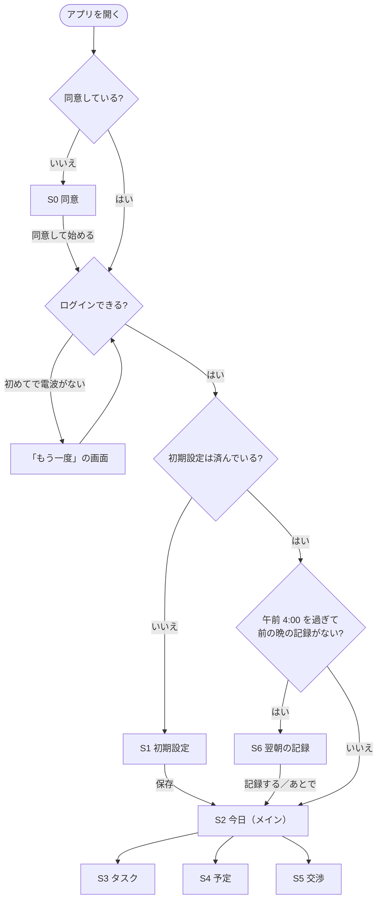

# Rism ベータ版 開発仕様書

- **版:** v2（2026-11-11・下書き）
- **共有範囲:** プロジェクトメンバー向け（特に開発メンバー）
- **この仕様書の「ベータ」:** 12 月に京大マーケの部員に使ってもらう**プライベートベータ**のことです。
- **元にした資料:** `docs/alpha_spec.md`（v17）、アルファのふりかえり、リポジトリの今の状態（`main` と PR #42、11/11 時点）
- **体制:** 開発 FT・IH・IK ／ マーケティング MH ／ 開発責任者（進行役）ぷらぐら（オーナー） ／ 技術の相談役 FT
- **読み方:** 全員 1・2・8 章、開発メンバーは 3〜7 章のうち自分の担当部分を読んでください。
- 「**【仮決め】**」は、オーナーが変えない限りこのまま進めてよい決め事です。「**開発者の判断でよい**」は、聞かずに決めて構いません。「**【要相談】**」は、決まるまで手を付けないでください。

---

## 0. アルファの仕様書との関係

アルファの仕様書（`docs/alpha_spec.md`）は、**下の表で「この仕様書に置き換え」とした所以外は、そのまま使います**（起床・限界時刻の計算、タスク、タイムラインの作り方、交渉の決め事など）。

| アルファの仕様書 | ベータでの扱い |
| --- | --- |
| 1.1 完成の条件、1.2 やらないこと | この仕様書の 1 章に置き換え |
| 3.6 のうち「AI の呼び出し方（アルファ）」（キーを `dart_defines.json` に置く、アプリから Gemini を直接呼ぶ） | この仕様書の 3.6 に置き換え。案のチェック・延長の計算・予備の案などの決め事はそのまま |
| 3.7 保存（端末内に保存） | この仕様書の 3.3 に置き換え。日付が変わったときの直し方（午前 4:00）はそのまま |
| 4 章 データの形 | そのまま使い、この仕様書の 5 章を足す |
| 5 章 技術の決め事（Chrome で動かす） | この仕様書の 7 章に置き換え。Git の決め事（5.1）はそのまま |
| 6 章 担当、8 章 Issue の一覧 | この仕様書の 3 章と、GitHub の Issue に置き換え。Issue・PR の番号の書き方（8.1）、毎日の 1 行報告（8.2）はそのまま |

---

## 1. ベータ版で確かめたいこと

> 京大マーケの部員（テスター）が、**説明なしで使い始めて、3 週間ふつうに使い続けられる**こと。そして「**就寝時刻が早くなったか**」を確かめられる記録が集まること。

アルファは「1 台のパソコンの Chrome で動けば成功」でした。ベータは**テスターのスマホで毎日使われる**ので、機能の数より「止まらない・消えない・迷わない」を大事にします。

### 1.1 ベータと呼べる条件

| # | 条件 | 確かめる日 |
| --- | --- | --- |
| 1 | 一連の流れが途切れずに使える：同意 → 初期設定 → 予定・タスク入力 → タイムライン → AI で調整 → 限界時刻の通知 → 翌朝の記録 | 11/22（機能がそろったか） |
| 2 | 3 週間毎日使っても、入力したデータや記録が消えない | 11/22（作りの確認）、11/28（メンバー内テスト） |
| 3 | 開発メンバーが横で説明しなくても、テスターが使い始められる（短い使い方ガイドつき） | 11/28 |
| 4 | iPhone・Android の両方で、メンバー内テストで致命的な不具合が出ていない | 11/28 |
| 5 | 集めた記録を、マーケティング担当が集計できる形で取り出せる | 11/28 |

- **11/22（日）：** 機能がそろったかを確かめ、これ以降は新しい機能を足さない（機能追加の締め切り）。
- **11/28（土）ごろ：** 5 つすべてを確かめ、オーナーが **11/30 に配るか、12/7 にずらすか**を決める。

### 1.2 完成の条件（メンバー内テストで、実機の iPhone・Android で次が動くこと）

| # | 操作 | 期待する結果 |
| --- | --- | --- |
| 1 | 配られたアプリを入れて、初めて開く | 同意画面（S0）が出る。同意しないと先に進めない |
| 2 | 同意する | 名前やメールアドレスを入れずに使い始められ（匿名ログイン）、初期設定（S1）が出る |
| 3 | 初期設定・予定・タスクを入れる | アルファと同じように、限界時刻とタイムラインが出る |
| 4 | タスクを消す、予定を直す・消す | タイムラインと限界時刻が作り直される |
| 5 | 「あと少し起きていたい」→ 案を選ぶ | アルファと同じように反映される。AI の呼び出しは、アプリに API キーを置かずに動く |
| 6 | アプリを閉じて待つ | 限界時刻の前と、限界時刻に通知が届く |
| 7 | 次の朝（午前 4:00 以降）に開く | 翌朝の記録（S6）が出て、寝た時刻・起きた時刻・目覚めを記録できる |
| 8 | 機内モードにして使い、あとで電波を戻す | 使っている間も止まらず、電波が戻るとデータがクラウドに保存される（初めて開くときを除く） |
| 9 | アプリを閉じて、次の日にまた開く | 入れたデータと記録が残っている |

### 1.3 ベータでやらないこと

Google・Apple でのログイン、課金、外部カレンダー連携、スマホいじり検知、長期のタスク管理、Web 版の公開、アプリが落ちたことを知らせる仕組み（Crashlytics）。

**配布のあと（12 月以降）に検討：** 「毎日のタスク」と「何時まで」（夕食・風呂を明日に回さない、買い物を深夜に置かない）、AI によるタスクの種類の提案。

---

## 2. 日程

| 時期 | 開発 | マーケティング・オーナー |
| --- | --- | --- |
| 11/9（月）〜11/15 | 準備（AI 向けの指示書の書き換え、PR #42 のマージ、アプリの ID、Firebase の導入とパッケージの追加）、クラウド保存、AI 呼び出しの移し替え、同意画面 | 測るもの（6.1）の案（**11/13 まで**）、同意書の下書き |
| 11/16〜11/22 | 翌朝の記録、通知、タスク・予定の削除、**メンバーへの最初の配布（11/18 ごろ）**、できれば機能。**11/22（日）機能追加の締め切り** | テスター募集、同意書・プライバシーポリシーの確定（**11/20 まで**） |
| 11/23〜11/29 | メンバー内テスト（実機）・不具合の修正、**iPhone 版の審査に提出（11/25 まで）**、記録の取り出し | 使い方ガイド、テスターの「使う前」の就寝時刻の記録、**配るかを決める（11/28 ごろ）** |
| **11/30（月）** | **ベータ配布** | ← |
| 12 月 | 不具合対応 | 部内テスト・データ集め |

**早めにメンバーへ一度配る（11/18 ごろ）：** 機能がそろっていなくても、メンバーのスマホに一度入れてみます。配布の手続きでつまずく所を、締め切りの前に見つけるためです。**Apple の登録がそれまでに済めば、iPhone（TestFlight）と Android（Firebase App Distribution）を同時に配ります。間に合わなければ、Android を先に配ります。**

---

## 3. 作るもの

### 3.1 一覧

**準備**（1 週目に先に済ませる。ほかの作業の前提になる）

| # | 内容 | 担当【仮決め】 | 章 |
| --- | --- | --- | --- |
| P1 | AI 向けの指示書（`CLAUDE.md`・`AGENTS.md`）と `README.md` をベータ用にする、この仕様書を `docs/beta_spec.md` に置く | オーナー | 8.2 |
| P2 | アプリの ID とバージョンを変える | FT | 3.7 |
| P3 | Firebase の導入と、パッケージをまとめて追加 | FT | 3.3、7 |
| P4 | 開発用に「今の時刻」を決められるようにする | FT | 3.13 |

**必須**（1.1 の条件に必要なもの）

| # | 内容 | 担当【仮決め】 | 章 |
| --- | --- | --- | --- |
| B1 | アルファの直し（PR #42 のマージ、限界時刻を過ぎたあとの交渉、片付け） | レビュー FT ／ 交渉 IH ／ 片付け IK | 3.2 |
| B2 | 匿名ログイン＋クラウド保存 | FT | 3.3 |
| B3 | 翌朝の記録（S6） | 保存 FT ／ 画面 IK | 3.4 |
| B4 | 限界時刻の通知 | IH | 3.5 |
| B5 | AI の API キーをアプリに置かない（Cloud Functions 経由） | IH | 3.6 |
| B6 | iPhone・Android で配布 | iPhone FT ／ Android IH | 3.7 |
| B7 | 同意画面（S0）とプライバシーポリシー | 画面 IK ／ 文面 IH（IK が手伝う） | 3.8 |
| B8 | 記録の取り出し（マーケティング担当が集計できる形） | IH | 3.9 |
| B9 | タスクの削除、予定の編集・削除 | 処理 FT ／ 画面 IK ／ S2 の予定の行 IH | 3.10 |

**できれば**（必須が遅れていたら後回し）

| # | 内容 | 担当【仮決め】 | 章 |
| --- | --- | --- | --- |
| C1 | 自由時間をタイムラインに出す | 計算 FT ／ 画面 IH | 3.11 |
| C2 | 「延長だけ」の案をアプリが足す | IH | 3.12 |

**担当の最新は、GitHub の Issue の「Assignees」を正とします**（アルファと同じ）。

### 3.2 B1 アルファの直し

- **交渉の「空く時間」の数えすぎ：** PR #42（IH）で直し済み。**FT がレビューしてマージし、Issue #13 を閉じる。**
- **限界時刻を過ぎたあとの交渉（決定）：** 限界時刻を過ぎたら、「あと少し起きていたい」を**押せないようにする**（IH）。画面には、アルファの 3.1 のとおり「限界時刻を過ぎています。今寝れば ○ 時間 ○ 分眠れます」だけを出す。睡眠を守るアプリなので、限界時刻のあとに延長を勧めないため。
- **片付け（IK。最初の PR の練習として）：** `lib/screens/placeholder_screen.dart`・`s3_demo_main.dart`・`s4_demo_main.dart` を消す。`ai_proto_main.dart`・`s5_demo_main.dart`・`negotiation_samples.dart` は B5 で消す（IH）。
- アルファの仕様書 1.1 #7 の書き方は、オーナーが直す（v18）。

### 3.3 B2 匿名ログイン＋クラウド保存

**ログイン**

- **Firebase Authentication の匿名ログイン**を使う。名前・メールアドレス・パスワードは聞かない。
- 同意（S0）のあとにログインする。同意の前にはデータを送らない。同意の記録はまず端末に置き、ログインしたあとで Firestore にも書く。
- **初めてのログインには電波が要る。** 電波がないときは「電波のある所で、もう一度お試しください」と「もう一度」ボタンを出す。2 回目以降に開くときは、電波がなくても使える。
- 新しく `lib/auth.dart` に「ログイン済みならそのまま、まだなら匿名ログインする」関数を作る（名前は**開発者の判断でよい**）。

**保存**

- **Cloud Firestore** に保存する。`lib/storage.dart` の公開している関数の形はそのままにし、中で `SharedPreferences` を使っている 3 か所（`_saveJson`・`_loadJson`・`clearAll`）だけを差し替える。画面の側は直さなくて済む。
- **保存先を差し替えられる形にする：** 本物は Firestore、テストではメモリの中に保存する版を使う。今の自動テスト（`storage_test`・`today_controller_test`・`widget_test`・PR #42 のテスト）が、`flutter test` と GitHub の自動チェックでそのまま通るようにするため。
- **書き込みは、サーバーの返事を待たない。** Firestore はオフラインのとき、書き込みが端末にはすぐ入るが、サーバーに届くまで終わらない。待つと、電波がないときに画面が止まるため。読み込みの仕方（端末の控えを先に読むかなど）は**開発者の判断でよい**。
- 保存の場所【仮決め】：`users/{ユーザーの ID}/` の下に、設定・時間割・予定・タスク・その晩の控え（5 章）・翌朝の記録・同意を置く。
- アルファで端末に保存したデータは、引き継がなくてよい。

**セキュリティルール**

- `firestore.rules`・`firebase.json`・`.firebaserc` をリポジトリに置き、**FT がデプロイする**。変えるときは必ず PR にして FT が確認する。
- `users/{ユーザーの ID}/` の下は**本人だけ**が読み書きできる。それ以外は全部断る。
- Firestore は「本番環境モード」で作ってあるので、ルールをデプロイするまでアプリからは何も読み書きできない。

**テスター ID**

- 設定画面（S1）の下に、短い「テスター ID」（ユーザー ID の先頭 6 文字など。**開発者の判断でよい**）を出す。テスターから「データを消してほしい」と言われたときに探すため。

**注意（テスターに伝える）：** 匿名ログインなので、アプリを消すとデータも記録も戻せない。使い方ガイドに「テスト中はアプリを消さないでください」と書く。

### 3.4 B3 翌朝の記録（S6）

**いつ出すか：** 日付が変わった（午前 4:00 を過ぎた）あとに初めて開いたとき、前の晩の記録がまだなければ、S2 より先に S6 を出す（初期設定がまだのときは S1 が先）。前の晩にアプリを開かなかった場合も出す。「あとで」を押すと S2 に進み、S2 の上部に「昨日の記録がまだです」と出す。

**入れるもの【仮決め・6.1 で MH の案を見て足す】**

| 項目 | 入れ方 | 初期値 |
| --- | --- | --- |
| 寝た時刻 | 時刻を選ぶ（5 分単位） | 前の晩の控え（5 章）の就寝時刻。控えがなければ 0:00 |
| 起きた時刻 | 時刻を選ぶ（5 分単位） | 今の時刻を 5 分単位に切り捨て |
| スッキリ起きられたか | 3 つから選ぶ：「スッキリ」「ふつう」「眠い」 | なし（必ず選ぶ） |

- **晩の日付：** 夜の側の日付（午前 4:00 で区切った「前の日」。今のコードの `todayOf()` が返す日付と同じ）。
- **時刻の持ち方：** アルファの 4 章と同じく、晩の日付の 0:00 からの分数。正午より前の時刻は次の日として 1440 を足す（例：寝た時刻 1:30 → 1530）。
- **入力のチェック：** 起きた時刻が寝た時刻より前になるときは、保存せずに「時刻を確かめてください」と出す。
- **直し方：** S2 の上部に、その日のうち（次の午前 4:00 まで）だけ「昨日の記録を直す」を出す。押すと S6 が開き、同じ晩の記録を上書きする。何日分もさかのぼって入れさせない。
- **一緒に保存するもの（アプリが自動で）：** その晩の控え（5 章）の限界時刻・就寝時刻・起床時刻・延長した分数と、記録した日時。控えがない晩は空のまま。

### 3.5 B4 限界時刻の通知

- `flutter_local_notifications`・`timezone`・`flutter_timezone` を使い、端末の中だけで出す通知にする（サーバーからは送らない）。パッケージの追加は FT に頼む（P3 でまとめて入れる）。
- **出す時刻【仮決め】：** 限界時刻の 30 分前と、限界時刻ちょうど。
- **文言【仮決め・UX で直してよい】**
  - 30 分前：「あと 30 分で限界時刻です。そろそろ片付けを始めましょう」
  - 限界時刻：「限界時刻になりました。スマホを置いて、寝る準備をしましょう」
- **予約を入れ直すのは、限界時刻が変わったときだけ**（交渉で延長したとき、予定・設定を変えたときなど）。S2 は 1 分ごとに作り直しているので、そのたびに入れ直さない。
- 予約するのはその晩の分だけ。その日に一度も開かなければ通知は出ないが、朝に S6 で開けばその晩の分が予約される。
- 正確なアラームの特別な許可は使わない。省電力中は数分以上遅れることがあるので、実機で確かめる。遅れが大きすぎたら【要相談】。
- **設定が要る所：** Android は通知の許可（Android 13 以降）、再起動のあとも予約を残す設定、ビルドの設定（desugaring）。iOS は許可の確認と `AppDelegate.swift`。
- 初めて予約するときに、通知の許可を求める。許可されなかったときは、S2 に「通知がオフです」と小さく出す。
- **通知の処理は差し替えられる形にする**（新しく `lib/notifications.dart`）。自動テストで本物の通知を出さないため。Web では何もしない。
- 「0:00 からの分数」（1440 以上もある）を実際の日時に直す処理は、午前 4:00 の区切りと合っているかを自動テストで確かめる。

### 3.6 B5 AI の API キーをアプリに置かない

**関数（`functions/` を新しく作る）**

- **Firebase の Cloud Functions** に、Gemini を呼ぶ関数を 1 つ作る。言語は TypeScript【仮決め】、地域は東京（`asia-northeast1`）。
- API キーは Secret Manager の **`GEMINI_API_KEY`** から読む（オーナーが入れてある。上書きしない）。アプリにもリポジトリにも入れない。
- **指示文・回答の形・モデル名は、関数の中に置く。** アプリから指示文を受け取る作りにすると、だれでも Gemini を何にでも使える入口になってしまうため。指示文の正は `docs/prompt_negotiation.md` で、関数はその写しとする。直したときは両方を直す。
- **ログインしていない呼び出しは断る。**
- **回数の上限【仮決め】：** 1 人 1 日 20 回、全員の合計で 1 日 500 回。「1 日」は日本時間の午前 4:00 で区切り、サーバー側で数える。回数の記録は `users/` の外に置き、アプリからは読み書きできないようにする。
- **エラーの返し方：** Gemini が混んでいる（503）ときは `unavailable`、回数の上限を超えたときは `resource-exhausted` を返す。
- **関数のログに、タスク名や交渉の理由を出さない。**
- しばらく呼ばれていないと、関数の起動に数秒かかる。そのせいで 10 秒を超えたら、予備の案を出すのでよい【仮決め】（関数を起動したままにする設定は使わない）。

**アプリ側**

- `gemini_client.dart` の `callGemini` を、関数を呼ぶ形に差し替える。**`GeminiResult` と `caller`（AI を差し替える口）の形は変えない。** 今の自動テスト（`negotiation_logic_test` と PR #42 のテスト）をそのまま生かすため。
- `unavailable` は 503 とみなして、アルファと同じく 1 回だけやり直す。`resource-exhausted` はやり直さずに予備の案を出す。合わせて 10 秒の上限はアルファと同じ。
- **案のチェック・延長の分数の計算・予備の案は、アルファと同じくアプリ側。**
- アプリの中のキー（`kGeminiKey`）、指示文（`negotiation_prompt.dart`・`kNegotiationSchema`）、開発用の入口（`ai_proto_main.dart`・`s5_demo_main.dart`・`negotiation_samples.dart`）を消す。README から `dart_defines.json` の手順を消す。
- **ベータでは Gemini を有料の設定で使う**（オーナーが設定済み）。テスターの本物の予定を送るため。
- B5 が終わったら、オーナーはアルファのキーを削除する。メンバーは手元の `dart_defines.json` を消す。

**手元で試すとき：** エミュレーターでは、アルファで渡したキーを `functions/.secret.local` に入れて使える。このファイルは `.gitignore` に入れ、テスト用のデータだけで試す。

### 3.7 B6 iPhone・Android で配布

**アプリの ID とバージョン（P2・FT）**

アプリの ID は **`app.rism.rism`**（iPhone の Bundle ID・Android の applicationId とも）。今の `com.example.rism` を次の所で変える。

- `android/app/build.gradle.kts`：`namespace` と `applicationId`
- `MainActivity.kt`：`kotlin/app/rism/rism/` に移し、`package` の行を直す
- `ios/Runner.xcodeproj/project.pbxproj`：6 か所（テスト用は `app.rism.rism.RunnerTests`）
- `android/app/src/main/AndroidManifest.xml`：`android:label` を `Rism` に
- `pubspec.yaml`：`version: 0.1.0+1`。配るたびに `+` の後ろの番号を 1 つ上げる

**iPhone（FT）**

- Mac の Xcode でビルドし、**TestFlight** で配る。
- `Info.plist` に `ITSAppUsesNonExemptEncryption`（false）を入れる。配るたびの暗号化の質問をなくすため。
- メンバーは「内部テスター」として、審査なしで先に試せる。部員テスターは「外部テスター」で、Apple の簡単な審査（1〜2 日かかることがある）が要るので、**11/25 までに提出**する。2 回目以降のビルドで審査がどうなるかは、提出のときに確かめる。
- 部員テスターは「公開リンク」で招待する（メールアドレスを集めずに済む）。
- 署名と TestFlight への上げ方は、新しく `docs/release.md` に書く。

**Android（IH）**

- 配布用のビルドに、**配布用の鍵**で署名する（今は開発用の鍵のまま）。`build.gradle.kts` で、鍵の情報を `android/key.properties` から読む。
- **鍵は 1 つ作って、ずっと同じものを使う。** 鍵が変わると上書きで入れられず、アプリを入れ直すことになり、匿名ログインなのでデータが全部消える。
- `key.properties`・`*.jks`・`*.keystore` を `.gitignore` に入れる。鍵はリポジトリにも LINE にも置かない。IH が保管し、オーナーも控えを持つ（渡し方は直接相談）。
- **Firebase App Distribution** で配る。審査はない。テスターのメールアドレスと、スマホで「提供元不明のアプリ」を許可することが要る（使い方ガイドに書く）。
- ふだんの確認はエミュレーターでよい。配る前に、Android のスマホを持つ人の実機で一度確かめる【要相談：誰の端末で確かめるか】。
- App Distribution への上げ方を `docs/release.md` に書く。

**不具合の受け取り方：** iPhone は TestFlight のフィードバックも使える。どちらも、問い合わせ先（3.8）で受け取る。

Apple・Firebase の登録やテスターの招待は、オーナーが行う。

### 3.8 B7 同意画面（S0）とプライバシーポリシー

- **文面（IH、IK が手伝う。11/20 まで）：** 同意書とプライバシーポリシー。集める項目は MH に聞く。
  - 同意書に書くこと：何を集めるか（予定・タスク・就寝と起床の記録・目覚めの評価）、何に使うか（就寝時刻が早くなったかを確かめる。個人が特定されない形でまとめて報告する）、いつまで持つか、途中でやめられること、データを消してほしいときの連絡先（テスター ID を伝えてもらう）。
  - プライバシーポリシーには、上の内容に加えて、運営する人、保存する場所（Firebase）、AI（Gemini）に送る内容（タスク名・時刻・交渉の理由）、**開発メンバーが不具合を調べるときにデータを見ることがあること**、**Android の配布でメールアドレスを使うこと**を書く。
  - オーナーが最後に確認する。
- **画面（IK）：** 新しく `lib/screens/consent_screen.dart`。初めて開いたときに出す。文面の要点、プライバシーポリシーへのリンク、「同意して始める」ボタン。同意しないと先に進めない。
- **同意の記録：** 同意した日時と、同意した文面の版を保存する。文面の版はアプリの中の定数にする（新しく `lib/config.dart`）。版が上がったら、もう一度同意画面を出す。
- **起動の流れ（IH、`main.dart`）：** 同意 → ログイン → S1（初期設定がまだのとき）→ S6（記録が要るとき）→ S2 の順にする（4 章の流れ図）。
- **設定画面（IK、`settings_screen.dart`）：** 下に「プライバシーポリシー」「問い合わせ先」のリンクと、テスター ID（3.3）を置く。リンクを開くのに `url_launcher` を使う（P3 で入れる）。
- **プライバシーポリシーを置く場所：** Firebase Hosting（`hosting/public/privacy.html`）。`firebase.json` に Hosting の設定を足す。

### 3.9 B8 記録の取り出し（IH、11/28 まで）

- Firestore の翌朝の記録を **CSV ファイル**に書き出す小さなスクリプトを作る（新しく `tools/export_sleep_logs/`）。1 行 1 晩、列は 3.4 の項目と、テスターごとの番号（ユーザー ID の代わりの通し番号）。
- **動かすのはオーナー。** 秘密の鍵のファイルは作らず、オーナーの Google アカウントでログインして動かす。
- **メンバーの試した記録を除けるように、**メンバーのユーザー ID の一覧を使う。一覧はリポジトリの外（オーナーの手元）に置く。
- `.gitignore` に `*.csv` を足す。
- 取り出した CSV は、オーナーが MH とだけ共有した Google ドライブのフォルダに置く。LINE グループや GitHub には上げない。

### 3.10 B9 タスクの削除、予定の編集・削除

3 週間使ってもらうには、間違えて入れたものを直せる必要がある（たとえば間違えて入れた「明日 7:00 の予定」を消せないと、起床時刻が早いままになる）。

- **処理（FT、`today_controller.dart`）：** タスクの削除・予定の削除の関数と、そのテストを足す。予定の編集（`editEvent`）はもうある。
- **画面（IK）：** タスクの画面（S3）と予定の画面（S4）に「削除」ボタンを足す。削除の前に「消しますか？」と確かめる。
- **S2（IH、`today_screen.dart`）：** 予定の行を押すと、S4 が編集の状態で開くようにする。

### 3.11 C1 自由時間をタイムラインに出す

- タイムラインで、タスクも予定も置かれていない時間を「自由時間」の行として出す（`slack_min` の計算を使う）。計算は FT、表示は IH。
- 交渉で理由を入れていた晩は、限界時刻の直前の自由時間に、その理由（例：「ドラマを見る時間」）を名前として付ける。理由は今は保存していないので、S5（IH）とつなぎ役（FT）で保存するようにする。
- 自由時間は完了チェックの対象にしない。

### 3.12 C2 「延長だけ」の案をアプリが足す（IH）

- 交渉の案に、アプリが「延長だけ（タスクはそのまま）」を足す。AI は使わない。予備の案を出すときにも足す。
- 出すのは、希望の延長がそのまま上限（最低限の睡眠・1 晩 60 分の残り）に収まるときだけ。
- **延長の案ばかりが目立たないようにする（決め事）：** 並べる順番は「今日は延長しない」の直前、目立つ色にしない、延長したあとの睡眠時間を一緒に出す（例：「延長だけ（延長 30分・睡眠 6時間30分）」）。

### 3.13 P4 開発用の「今の時刻」（FT）

- 開発用のビルドでだけ、`TodayController(clock:)` に決めた時刻を渡せるようにする（例：`--dart-define` で時刻を指定）。S6（午前 4:00）や通知を、時間を待たずに確かめるため。
- 配布用のビルドでは使えないようにする。

---

## 4. 画面と流れ

| 画面 | 内容 | ベータでの変更 |
| --- | --- | --- |
| S0 同意（新） | 同意書の要点、プライバシーポリシーへのリンク、「同意して始める」 | B7 |
| S1 初期設定 | アルファと同じ | 下にプライバシーポリシー・問い合わせ先のリンク、テスター ID（B7） |
| S2 今日（メイン） | アルファと同じ | 限界時刻のあとは「あと少し起きていたい」を押せない（B1）、「昨日の記録がまだです」「昨日の記録を直す」（B3）、「通知がオフです」（B4）、予定の行を押すと編集（B9）、自由時間の行（C1） |
| S3 タスク | アルファと同じ | 「削除」ボタン（B9） |
| S4 予定 | アルファと同じ | 編集の状態で開ける、「削除」ボタン（B9） |
| S5 交渉 | アルファと同じ | 「延長だけ」の案（C2） |
| S6 翌朝の記録（新） | 寝た時刻・起きた時刻・目覚め | B3 |

画面の細かな配置・色・文言は、アルファと同じく **UX/UI 担当と開発者の判断でよい**。

---

## 5. データの形（アルファの 4 章に足すもの）

| データ | 項目 | 保存の場所【仮決め】 |
| --- | --- | --- |
| 同意 Consent | 同意した文面の版、同意した日時 | まず端末、ログイン後に `users/{ID}/` |
| その晩の控え NightPlan | 晩の日付、限界時刻、就寝時刻、起床時刻、延長した分数 | `users/{ID}/nightPlans/{晩の日付}` |
| 翌朝の記録 SleepLog | 晩の日付、寝た時刻、起きた時刻、目覚め、その晩の控えの 4 項目、記録した日時 | `users/{ID}/sleepLogs/{晩の日付}` |
| AI の回数 | 日付、ユーザーごとの回数、合計の回数 | `users/` の外（アプリからは読み書きできない） |

- **その晩の控え：** 限界時刻が変わるたびに、その晩の控えを上書きする。今の「交渉の記録」（最後の 1 晩分だけを持つ `saveExtendedMin`）の代わりに使い、延長の分数も晩ごとに残す。翌朝に「あとで」を押してその夜にまた交渉しても、前の晩の分が消えないようにするため。
- **目覚め：** 1 ＝ 眠い、2 ＝ ふつう、3 ＝ スッキリ（大きいほどよい）。
- 時刻の持ち方（晩の日付の 0:00 からの分数、日付をまたぐ時刻は 1440 以上）はアルファと同じ。
- **個人を特定できる情報（名前・メールアドレス・電話番号・位置情報）は集めない。**

---

## 6. マーケティングとのつなぎ

### 6.1 測るもの（MH、11/13 まで）

- 翌朝の記録（3.4）の項目で足りるか、足すものがあるかを決める。例：寝る前にスマホを使った時間（自己申告）、アプリを開いた日数。
- 「使う前」の就寝時刻とアプリの記録を、**人ごとに比べるか、全体の平均で比べるか**を決める。人ごとに比べる場合は、テスターごとの番号を決め、アプリに入れてもらう欄（S1）を足す必要がある。
- テスターに毎日お願いすることが多すぎないかも見る（記録は 30 秒以内で終わるのが目安）。
- 決まったら、開発はそれに合わせて S6 とデータの形を直す。**11/15 以降は項目を増やさない**（翌朝の記録の締め切りに間に合わせるため）。

### 6.2 使い方ガイド（11/23〜11/29）

1 枚で、入れ方（iPhone の TestFlight、Android の「提供元不明のアプリ」の許可）・最初の設定・毎朝の記録・「アプリを消さないでください」・問い合わせ先を書く。開発メンバーが内容を確かめる。

---

## 7. 技術の決め事（アルファの 5 章に置き換え）

| 項目 | 内容 |
| --- | --- |
| 動かす環境 | **iPhone・Android の実機とシミュレーター／エミュレーター**。Chrome（Web）で確かめるなら、`flutterfire configure` で Web も選ぶ。通知は Web では動かない |
| Firebase | プロジェクト `rism-85e9d`（オーナーが作成済み）。Authentication（匿名）、Cloud Firestore（東京・本番環境モード）、Cloud Functions、Hosting |
| Firebase の設定ファイル | `flutterfire configure` で作る（iOS・Android・Web）。できたファイル（`firebase_options.dart`・`google-services.json`・`GoogleService-Info.plist`）は**リポジトリに入れてよい（決定）**。中のキーは秘密ではなく、使い道はオーナーが Firebase のものだけに絞る。`flutterfire configure` をしたら、オーナーに知らせる |
| パッケージ | P3 で、FT がまとめて 1 回で入れる：`firebase_core`・`firebase_auth`・`cloud_firestore`・`cloud_functions`・`flutter_local_notifications`・`timezone`・`flutter_timezone`・`url_launcher`。そのあとは、各自が並行して作業できる |
| Firebase のプロジェクト | 1 つ。開発メンバーの試したデータは、3.9 のとおり集計から除く |

### 7.1 ファイルの持ち主

同じファイルを別々の人が直すと、ぶつかります（アルファで何度も起きました）。次のファイルは持ち主だけが直し、ほかの人は持ち主に頼みます。

| ファイル | 持ち主 |
| --- | --- |
| `pubspec.yaml`、`lib/storage.dart`（と保存先）、`lib/today_controller.dart`、`firestore.rules`・`firebase.json`、`ios/` | FT |
| `lib/main.dart`、`lib/screens/today_screen.dart`、`lib/ai_adjust/`、`lib/notifications.dart`、`functions/`、`tools/`、`android/`（P2 のあと） | IH |
| `lib/screens/consent_screen.dart`、`lib/screens/sleep_log_screen.dart`、`lib/screens/settings_screen.dart`、`lib/screens/task_edit_screen.dart`、`lib/screens/event_edit_screen.dart` | IK |
| `CLAUDE.md`・`AGENTS.md`・`README.md`・`docs/` | オーナー |

### 7.2 データとキーの扱い（ベータで厳しくすること）

- テスターの本物のデータを扱うので、**テスターのデータが写った画面のスクリーンショットや CSV を、LINE グループ・GitHub・Issue・AI ツールのチャット欄に貼らない。**
- **Firebase の管理画面のテスターのデータは、不具合を調べるときだけ見る。**
- API キー・Android の配布用の鍵・Firebase の管理画面のパスワードは、コードにも LINE にも書かない。
- Firestore のセキュリティルールを変えるときは、必ず PR にして FT が確認する。

---

## 8. 進め方

アルファの 5.1（Git の決め事）・8.1（「Issue #3」「PR #26」の書き方）・8.2（毎日の 1 行報告）はそのまま続けます。ふりかえりから、次のことを足します。

1. **途中でも早めに push し、下書きの PR を出す。** 毎日の 1 行報告と一緒に、進み具合が見えるようにする。
2. **同じファイルは持ち主を 1 人に決める**（7.1）。
3. **PR の上に PR を重ねない。** 重ねるときは、PR の説明にマージの順番を書く。
4. **Issue には「どのファイルを、どう変えるか」まで書く。** オーナーが Claude と一緒に書く。わからないところは Issue のコメントで聞く。
5. **PR の説明に、AI に頼んだ「初心者向けの 3 行の説明」と「確認したこと」を書く。**
6. **レビューで直してほしい点は、最初のレビューでまとめて伝える。**
7. AI ツールに GitHub CLI（`gh`）を入れて、Issue や PR を直接読ませてよい。
8. コミットの作者名を自分の名前にする（`git config user.name`）。

### 8.1 遅れたときに削る順番

1. C1（自由時間）
2. C2（延長だけ）
3. 通知の 30 分前の分（限界時刻ちょうどの通知だけ残す）

準備（P1〜P4）と B1〜B9 は削らない。削るしかないときは、オーナーが配布を 12/7 にずらすかを決めます。

### 8.2 AI 向けの指示書（P1・オーナー）

`CLAUDE.md`・`AGENTS.md`（同じ内容）と `README.md` は、アルファの決め事（「ログイン・クラウド保存はやらない」「Chrome で動かす」「キーは `dart_defines.json`」）のままです。このままだと、各自の AI ツールがベータの作業に逆らうので、最初に直します。

- 読むものに `docs/beta_spec.md` を足し、アルファの仕様書との関係（0 章）を書く。
- Firebase の決め事、Firebase の設定ファイルの扱い（7 章）、ファイルの持ち主（7.1）を足す。
- `README.md` に、スマホでの動かし方を書く。

**片付け（オーナー）：** Issue #13（PR #42 のマージのあと）・#14・#15 を閉じ、Issue の担当から抜けたメンバーを外す。使い終わった作業用のブランチを消す。

---

## 9. オーナー（ぷらぐら）がやること

| いつまで | やること |
| --- | --- |
| 済 | Firebase のプロジェクト（Blaze・予算アラート・Firestore・匿名ログイン）、開発メンバーの招待、Gemini の有料のキーを Secret Manager に入れる |
| すぐ | P1（指示書の書き換え）と片付け。Apple Developer Program の登録が済んだら `app.rism.rism` を登録して FT に知らせる。Gemini API の 1 日の回数に上限を付ける（Google Cloud の割り当て） |
| `flutterfire configure` のあと | Firebase が作ったキーの使い道を、Firebase のものだけに絞る（Gemini API を入れない） |
| 11/16 | App Store Connect にアプリを作り（名前「Rism」が使えるか確かめる）、開発メンバーを内部テスターに入れる。Firebase App Distribution にメンバーを入れる |
| 11/20 | 同意書・プライバシーポリシーを確認する |
| 11/22 | 機能がそろったかを確かめる（1.1） |
| 11/25 | TestFlight の外部テストの審査に提出する（説明・連絡先・プライバシーポリシーの URL などのテスト情報を入れる） |
| 11/28 ごろ | 1.1 の 5 つを確かめ、11/30 に配るか 12/7 にずらすかを決める |
| B5 のあと | アルファの Gemini のキーを削除する |
| 配布のあと | 記録の取り出しを動かし、CSV を MH と共有した Google ドライブに置く |
| 期間中 | 仕様の質問にその日のうちに答える。Issue を書く。Android の配布用の鍵の控えを持つ |

---

## 10. まだ決まっていないこと

| 項目 | 今の扱い | 決める人 |
| --- | --- | --- |
| 翌朝の記録の項目 | 3.4 の 3 つ。MH の案で足す | MH → オーナー（11/13） |
| 使う前と使った後を人ごとに比べるか | 未定。人ごとなら S1 に番号の欄を足す | MH → オーナー（11/13） |
| Android の実機で確かめる人・端末 | 未定 | オーナー |
| 通知の時刻・文言 | 3.5 の【仮決め】 | UX・開発 |
| AI の回数の上限 | 1 人 1 日 20 回、合計 1 日 500 回【仮決め】 | オーナー |
| 一度短縮したタスクを通常版に戻すか（アルファで先送り） | 戻さないまま | FT が案を出す |
| 正規のアプリからの呼び出しだけを通す仕組み（App Check） | 使わない。Android を Google Play を通さずに配るので、使えるかは確認が必要 | FT・IH |
