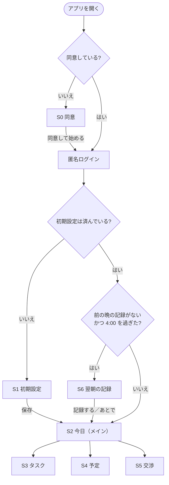

# Rism ベータ版 開発仕様書

- **版:** v1（2026-11-11・下書き）
- **共有範囲:** プロジェクトメンバー向け（特に開発メンバー）
- **元にした資料:** `project.md` 4.2、`docs/alpha_spec.md`（v17）、「ベータ版 参加のご案内」、アルファのふりかえり
- **体制:** 開発 FT・IH・IK ／ マーケティング MH ／ 開発責任者（進行役）ぷらぐら（オーナー） ／ 技術の相談役 FT
- **読み方:** 全員 1・2・8 章、開発メンバーは 3〜7 章のうち自分の担当部分を読んでください。アルファの仕様書（`docs/alpha_spec.md`）に書いたことは、この仕様書で変えない限りそのまま使います。
- 「**【仮決め】**」は、オーナーが変えない限りこのまま進めてよい決め事です。「**開発者の判断でよい**」は、聞かずに決めて構いません。「**【要相談】**」は、決まるまで手を付けないでください。

---

## 1. ベータ版で確かめたいこと

> 京大マーケの部員（テスター）が、**説明なしで使い始めて、3 週間ふつうに使い続けられる**こと。そして「**就寝時刻が早くなったか**」を確かめられる記録が集まること。

アルファは「1 台のパソコンの Chrome で動けば成功」でした。ベータは**テスターのスマホで毎日使われる**ので、機能の数より「止まらない・消えない・迷わない」を大事にします。

### 1.1 ベータと呼べる条件（11/22 の機能追加の締め切りで確認）

- [ ] 一連の流れが途切れずに使える：同意 → 初期設定 → 予定・タスク入力 → タイムライン → AI で調整 → 限界時刻の通知 → 翌朝の記録
- [ ] 3 週間毎日使っても、入力したデータや記録が消えない
- [ ] 開発メンバーが横で説明しなくても、テスターが使い始められる（短い使い方ガイドつき）
- [ ] iPhone・Android の両方で、メンバー内テストで致命的な不具合が出ていない
- [ ] 集めた記録を、マーケティング担当が集計できる形で取り出せる

満たせない場合は、配布を 1 週間遅らせる（12/7）か、テスター数を絞って配ります。

### 1.2 完成の条件（メンバー内テストで、実機の iPhone・Android で次が動くこと）

| # | 操作 | 期待する結果 |
| --- | --- | --- |
| 1 | 配られたアプリを入れて、初めて開く | 同意画面（S0）が出る。同意しないと先に進めない |
| 2 | 同意する | 名前やメールアドレスを入れずに使い始められ（匿名ログイン）、初期設定（S1）が出る |
| 3 | 初期設定・予定・タスクを入れる | アルファと同じように、限界時刻とタイムラインが出る |
| 4 | 「あと少し起きていたい」→ 案を選ぶ | アルファと同じように反映される。AI の呼び出しはアプリに API キーを置かずに動く |
| 5 | アプリを閉じて待つ | 限界時刻の前と、限界時刻に通知が届く |
| 6 | 次の朝（午前 4:00 以降）に開く | 翌朝の記録（S6）が出て、就寝時刻・起床時刻・目覚めを記録できる |
| 7 | アプリを閉じて、次の日にまた開く | 入れたデータと記録が残っている |

### 1.3 ベータでやらないこと

Google・Apple でのログイン、課金、外部カレンダー連携、スマホいじり検知、長期のタスク管理、AI によるタスクの種類の提案（12 月以降に検討）、Web 版の公開。

---

## 2. 日程

| 時期 | 開発 | マーケティング・オーナー |
| --- | --- | --- |
| 11/9（月）〜11/15 | Firebase の準備、アプリの ID の変更、クラウド保存、AI 呼び出しの移し替え、同意画面、アルファの直し | 測るもの（6.1）の案（**11/13 まで**）、同意書の下書き |
| 11/16〜11/22 | 翌朝の記録、通知、**メンバーへの最初の配布（11/18 ごろ）**、できれば機能。**11/22（日）機能追加の締め切り** | テスター募集、同意書・プライバシーポリシーの確定（**11/20 まで**） |
| 11/23〜11/29 | メンバー内テスト（実機）・不具合の修正、**iPhone 版の審査に提出（11/25 まで）** | 使い方ガイド、テスターの「使う前」の就寝時刻の記録 |
| **11/30（月）** | **ベータ配布** | ← |
| 12 月 | 不具合対応 | 部内テスト・データ集め |

**早めにメンバーへ一度配る（11/18 ごろ）：** 機能がそろっていなくても、iPhone（TestFlight）・Android（Firebase App Distribution）でメンバーのスマホに一度入れてみます。配布の手続きでつまずく所を、締め切りの前に見つけるためです。

---

## 3. 作るもの

### 3.1 一覧

**必須**（1.1 の条件に必要なもの）

| # | 内容 | 担当【仮決め】 | 章 |
| --- | --- | --- | --- |
| B1 | アルファの直し（交渉で「空く時間」を数えすぎる問題など） | IH | 3.2 |
| B2 | 匿名ログイン＋クラウド保存 | FT | 3.3 |
| B3 | 翌朝の記録（S6） | 画面 IK ／ 保存 FT | 3.4 |
| B4 | 限界時刻の通知 | IH | 3.5 |
| B5 | AI の API キーをアプリに置かない（Cloud Functions 経由） | IH | 3.6 |
| B6 | iPhone・Android で配布 | iPhone FT ／ Android IH | 3.7 |
| B7 | 同意画面（S0）とプライバシーポリシー | 画面 IK ／ 文面 IH（IK が手伝う） | 3.8 |
| B8 | 記録の取り出し（マーケティング担当が集計できる形） | FT | 3.9 |

**できれば**（アルファで出た改善。必須が遅れていたら後回し）

| # | 内容 | 担当【仮決め】 | 章 |
| --- | --- | --- | --- |
| C1 | 自由時間をタイムラインに出す | FT | 3.10 |
| C2 | 「延長だけ」の案をアプリが足す | IH | 3.11 |
| C3 | 「毎日のタスク」と「何時まで」 | 計算 FT ／ 画面 IH | 3.12 |

**担当の最新は、GitHub の Issue の「Assignees」を正とします**（アルファと同じ）。

### 3.2 B1 アルファの直し

- 交渉で、自動で明日に回したタスク・短縮したタスクの「空く時間」を数えすぎる問題を直す（直し方は PR #36 のコメントと `docs/alpha_spec.md` 3.6「送るタスクの時間と状態は、今のタイムラインに合わせる」のとおり）。
- アルファの仕様書 1.1 #7 の書き方を直す（「延長なし」なら限界時刻は変わらない）。
- 使わなくなったファイル（`lib/screens/placeholder_screen.dart`）を片付ける。

### 3.3 B2 匿名ログイン＋クラウド保存

- **Firebase Authentication の匿名ログイン**を使う。名前・メールアドレス・パスワードは聞かない。同意（S0）のあとにログインする（同意の前にはデータを送らない）。
- **Cloud Firestore** に保存する。アルファの `lib/storage.dart` の関数の形（呼び出し方）はできるだけ変えずに、中身を Firestore に差し替える。画面の側は直さなくて済むようにするため。
- 保存の場所【仮決め】：`users/{ユーザーの ID}/` の下に、設定・時間割・予定・タスク・交渉の記録・翌朝の記録・同意を置く。
- **自分のデータしか読み書きできない**ようにセキュリティルールを書く（ほかの人のユーザー ID の下は読めない・書けない）。
- 電波がないときも使えるように、Firestore のオフラインの保存（初めから有効）をそのまま使う。
- アルファで端末に保存したデータは、引き継がなくてよい。
- **注意（テスターに伝える）：** 匿名ログインなので、アプリを消すとデータも記録も戻せない。使い方ガイドに「テスト中はアプリを消さないでください」と書く。

### 3.4 B3 翌朝の記録（S6）

**いつ出すか：** 日付が変わった（午前 4:00 を過ぎた）あとに初めて開いたとき、前の晩の記録がまだなければ、S1・S2 より先に S6 を出す。「あとで」を押すと S2 に進み、S2 の上部に「昨日の記録がまだです」と出す。

**入れるもの【仮決め・6.1 で MH の案を見て足す】**

| 項目 | 入れ方 | 初期値 |
| --- | --- | --- |
| 寝た時刻 | 時刻を選ぶ（5 分単位） | 前の晩の就寝時刻（予定） |
| 起きた時刻 | 時刻を選ぶ（5 分単位） | 今の時刻を 5 分単位に切り捨て |
| スッキリ起きられたか | 3 つから選ぶ：「スッキリ」「ふつう」「眠い」 | なし（必ず選ぶ） |

**一緒に保存するもの（アプリが自動で）：** その晩の限界時刻・就寝時刻（予定）・起床時刻（予定）、延長した分数、記録した日時。「予定と実際の差」を集計で見るため。

- 1 晩に 1 つ。あとから直せる（同じ晩の記録を上書き）。
- 記録しなかった晩は「なし」のまま。何日分もさかのぼって入れさせない。

### 3.5 B4 限界時刻の通知

- `flutter_local_notifications` などで、端末の中だけで出す通知を使う（サーバーからは送らない）。使うパッケージは**開発者の判断でよい**。
- **出す時刻【仮決め】：** 限界時刻の 30 分前と、限界時刻ちょうど。
- **文言【仮決め・UX で直してよい】**
  - 30 分前：「あと 30 分で限界時刻です。そろそろ片付けを始めましょう」
  - 限界時刻：「限界時刻になりました。スマホを置いて、寝る準備をしましょう」
- タイムラインを作り直すたびに（交渉の延長で限界時刻が変わったときなど）、予約した通知を消して入れ直す。
- 数分ずれても構わない（Android の「正確なアラーム」の特別な許可は使わない）。
- 初めて通知を予約するときに、通知の許可を求める。許可されなかったときは、S2 に「通知がオフです」と小さく出す。

### 3.6 B5 AI の API キーをアプリに置かない

- **Firebase の Cloud Functions** に、Gemini を呼ぶ関数を 1 つ作る。API キーは Cloud Functions の秘密の保存場所（Secret Manager）に置き、アプリにもリポジトリにも入れない。
- アプリはアルファと同じ内容（`docs/alpha_spec.md` 3.6 の「AI に送る内容」）を関数に送り、関数は Gemini の返事をそのまま返す。**案のチェック・延長の分数の計算・予備の案は、アルファと同じくアプリ側**（今の自動テストを生かすため）。
- 匿名ログインしている人だけが呼べるようにする。
- **1 人 1 日の呼び出し回数に上限**を付ける【仮決め：20 回】。超えたら予備の案を出す。
- 10 秒の時間切れ・503 のときの 1 回だけのやり直しは、アルファと同じ。
- **ベータでは Gemini を有料の設定で使う**（オーナーが設定する）。無料枠では、送った内容が Google のサービス改善に使われることがあり、テスターの本物の予定を送るためです。
- 関数を書く言語（TypeScript など）は**開発者の判断でよい**。地域は東京（`asia-northeast1`）【仮決め】。

### 3.7 B6 iPhone・Android で配布

- **アプリの ID：** `app.rism.rism`（iPhone の Bundle ID・Android の applicationId とも）。今の `com.example.rism` から変える（FT）。
- **iPhone（FT）：** Mac の Xcode でビルドし、**TestFlight** で配る。メンバーは「内部テスター」として審査なしで先に試せる。部員テスターは「外部テスター」で、Apple の簡単な審査（1〜2 日かかることがある）が要るので、**11/25 までに提出**する。
- **Android（IH）：** ビルドして **Firebase App Distribution** で配る。審査はない。ふだんの確認はエミュレーターでよい。配る前に、Android のスマホを持つ人の実機で一度確かめる【要相談：誰の端末で確かめるか】。
- 配るたびにバージョン番号を上げる（例：0.1.0（1）→ 0.1.0（2））。
- Apple・Firebase の登録やテスターの招待は、オーナーが行う。

### 3.8 B7 同意画面（S0）とプライバシーポリシー

- **文面（IH、IK が手伝う。11/20 まで）：** 同意書とプライバシーポリシー。
  - 同意書に書くこと：何を集めるか（予定・タスク・就寝と起床の記録・目覚めの評価）、何に使うか（就寝時刻が早くなったかを確かめる。個人が特定されない形でまとめて報告する）、いつまで持つか、途中でやめられること、データを消してほしいときの連絡先。
  - プライバシーポリシーには、上の内容に加えて、運営する人、保存する場所（Firebase）、AI（Gemini）に送る内容（タスク名・時刻・交渉の理由）を書く。
  - オーナーが最後に確認する。
- **画面（IK）：** 初めて開いたときに出す。文面の要点、プライバシーポリシーへのリンク、「同意して始める」ボタン。同意しないと先に進めない。
- 同意した日時と、同意した文面の版を保存する。文面の版が上がったら、もう一度同意画面を出す。
- S1（設定）の下に「プライバシーポリシー」と「問い合わせ先」のリンクを置く。
- プライバシーポリシーを置く場所【仮決め】：Firebase Hosting（同じ Firebase プロジェクトで、無料で公開できるため）。

### 3.9 B8 記録の取り出し

- オーナーまたは FT が、Firestore の記録を **CSV ファイル**に書き出せるようにする（小さなスクリプトでよい）。1 行 1 晩、列は 3.4 の項目と、テスターごとの番号（ユーザー ID の代わりの通し番号）。
- **メンバーの試した記録を除けるように**、メンバーのユーザー ID の一覧を別に持っておく。
- 取り出した CSV はマーケティング担当に渡す。LINE グループや GitHub には上げない。

### 3.10 C1 自由時間をタイムラインに出す

- タイムラインで、タスクも予定も置かれていない時間を「自由時間」の行として出す（`slack_min` の計算を使う）。
- 交渉でタスクを削って空いた時間は、交渉の理由を入れていればその文（例：「ドラマを見る時間」）を自由時間の名前にする。
- 自由時間は完了チェックの対象にしない。

### 3.11 C2 「延長だけ」の案をアプリが足す

- 交渉の案に、アプリが「延長だけ（タスクはそのまま）」を足す。AI は使わない。
- 出すのは、希望の延長がそのまま上限（最低限の睡眠・1 晩 60 分の残り）に収まるときだけ。
- **延長の案ばかりが目立たないようにする（決め事）：** 並べる順番は「今日は延長しない」の直前、目立つ色にしない、延長したあとの睡眠時間を一緒に出す（例：「延長だけ（延長 30分・睡眠 6時間30分）」）。

### 3.12 C3 「毎日のタスク」と「何時まで」

- **毎日のタスク：** S3 にチェックを足す。日付が変わったとき、完了していても消さずに未完了に戻す。タイムラインでは**自動で明日に回さない**（短縮はしてよい）。夕食・風呂を明日に回さないため。
- **何時まで：** S3 に「何時までにやる」（任意）を足す。そのタスクは、終わりがその時刻までに収まる空き時間にだけ置く。入らなければ短縮を試し、それでも入らなければ「明日に回す」に入れる。買い物を深夜に置かないため。
- 細かい順番の決まりは、FT が案を作り、PR で確認する。

---

## 4. 画面と流れ

| 画面 | 内容 | ベータでの変更 |
| --- | --- | --- |
| S0 同意（新） | 同意書の要点、プライバシーポリシーへのリンク、「同意して始める」 | B7 |
| S1 初期設定 | アルファと同じ | 下にプライバシーポリシー・問い合わせ先のリンク |
| S2 今日（メイン） | アルファと同じ | 自由時間の行（C1）、「昨日の記録がまだです」（B3）、「通知がオフです」（B4） |
| S3 タスク | アルファと同じ | 「毎日のタスク」「何時まで」（C3） |
| S4 予定 | アルファと同じ | — |
| S5 交渉 | アルファと同じ | 「延長だけ」の案（C2） |
| S6 翌朝の記録（新） | 寝た時刻・起きた時刻・目覚め | B3 |

画面の細かな配置・色・文言は、アルファと同じく **UX/UI 担当と開発者の判断でよい**。

---

## 5. データの形（アルファの 4 章に足すもの）

| データ | 項目 |
| --- | --- |
| 同意 Consent | 同意した文面の版、同意した日時 |
| 翌朝の記録 SleepLog | 晩の日付、寝た時刻、起きた時刻、目覚め（1〜3）、限界時刻（予定）、就寝時刻（予定）、起床時刻（予定）、延長した分数、記録した日時 |
| タスク Task（追加） | 毎日のタスクか、何時まで（なしでもよい） |

- 時刻の持ち方（その日の 0:00 からの分数、日付をまたぐ時刻は 1440 以上）はアルファと同じ。
- **個人を特定できる情報（名前・メールアドレス・電話番号・位置情報）は集めない。**

---

## 6. マーケティングとのつなぎ

### 6.1 測るもの（MH、11/13 まで）

- 翌朝の記録（3.4）の項目で足りるか、足すものがあるかを決める。例：寝る前にスマホを使った時間（自己申告）、アプリを開いた日数。
- テスターに毎日お願いすることが多すぎないかも見る（記録は 30 秒以内で終わるのが目安）。
- 決まったら、開発はそれに合わせて S6 と SleepLog を直す。**11/15 以降は項目を増やさない**（翌朝の記録の締め切りに間に合わせるため）。

### 6.2 使い方ガイド（11/23〜11/29）

1 枚で、入れ方・最初の設定・毎朝の記録・「アプリを消さないでください」・問い合わせ先を書く。開発メンバーが内容を確かめる。

---

## 7. 技術の決め事（アルファの 5 章に足すもの）

| 項目 | 内容 |
| --- | --- |
| 動かす環境 | **iPhone・Android の実機とシミュレーター／エミュレーター**。Chrome（Web）は開発中の確認だけに使ってよい |
| Firebase | Authentication（匿名）、Cloud Firestore、Cloud Functions、Hosting。プロジェクトはオーナーが作って開発メンバーを招待する。Flutter への設定は `flutterfire configure` で行う |
| Firebase のプロジェクト | 1 つ【仮決め】。開発メンバーの試したデータは、3.9 のとおり集計から除く |
| パッケージの追加 | `pubspec.yaml` を直すのは **FT に決める**（アルファで何度もぶつかったため）。パッケージを足したいときは、Issue か PR で FT に頼む |

### 7.1 データとキーの扱い（ベータで厳しくすること）

- テスターの本物のデータを扱うので、**テスターのデータが写った画面のスクリーンショットや CSV を、LINE グループ・GitHub・Issue・AI ツールのチャット欄に貼らない。**
- API キー・Firebase の管理画面のパスワードは、コードにも LINE にも書かない。
- Firestore のセキュリティルールを変えるときは、必ず PR にして FT が確認する。

---

## 8. 進め方

アルファの 5.1（Git の決め事）・8.1（Issue の書き方：「Issue #3」「PR #26」）・8.2（毎日の 1 行報告）はそのまま続けます。ふりかえりから、次のことを足します。

1. **途中でも早めに push し、下書きの PR を出す。** 毎日の 1 行報告と一緒に、進み具合が見えるようにする。
2. **同じファイルは担当を 1 人に決める**（`pubspec.yaml` は FT、`lib/storage.dart` は FT、交渉まわりは IH）。
3. **PR の上に PR を重ねない。** 重ねるときは、PR の説明にマージの順番を書く。
4. **Issue には「どのファイルを、どう変えるか」まで書く。** オーナーが Claude と一緒に書く。わからないところは Issue のコメントで聞く。
5. **PR の説明に、AI に頼んだ「初心者向けの 3 行の説明」と「確認したこと」を書く。**
6. **レビューで直してほしい点は、最初のレビューでまとめて伝える。**
7. AI ツールに GitHub CLI（`gh`）を入れて、Issue や PR を直接読ませてよい。

### 8.1 遅れたときに削る順番

1. C3（毎日のタスク・何時まで）
2. C1（自由時間）
3. C2（延長だけ）
4. 通知の 30 分前の分（限界時刻ちょうどの通知だけ残す）

B1〜B8 は削らない。削るしかないときは、オーナーが配布を 12/7 にずらすかを決めます。

---

## 9. オーナー（ぷらぐら）がやること

| いつまで | やること |
| --- | --- |
| すぐ | Apple Developer Program に登録し、`app.rism.rism` を登録する。Firebase プロジェクトを作り、従量課金と予算アラートを設定して、開発メンバーを招待する |
| 11/13 | Gemini を有料の設定にする（予算アラートつき）。Cloud Functions の秘密の保存場所に API キーを入れる |
| 11/16 | App Store Connect にアプリを作り、開発メンバーを内部テスターに入れる。Firebase App Distribution にメンバーを入れる |
| 11/20 | 同意書・プライバシーポリシーを確認する |
| 11/22 | 1.1 の条件を確認し、11/30 に配るか 12/7 にずらすかを決める |
| 11/25 | TestFlight の外部テストの審査に提出する |
| 期間中 | 仕様の質問にその日のうちに答える。Issue を書く |

---

## 10. まだ決まっていないこと

| 項目 | 今の扱い | 決める人 |
| --- | --- | --- |
| 翌朝の記録の項目 | 3.4 の 3 つ。MH の案で足す | MH → オーナー（11/13） |
| Android の実機で確かめる人・端末 | 未定 | オーナー |
| 通知の時刻・文言 | 3.5 の【仮決め】 | UX・開発 |
| 1 人 1 日の AI 呼び出しの上限 | 20 回【仮決め】 | オーナー |
| 一度短縮したタスクを通常版に戻すか（アルファで先送り） | 戻さないまま | FT が案を出す |
| 「何時まで」の細かい決まり | 3.12 | FT が案を出す |
