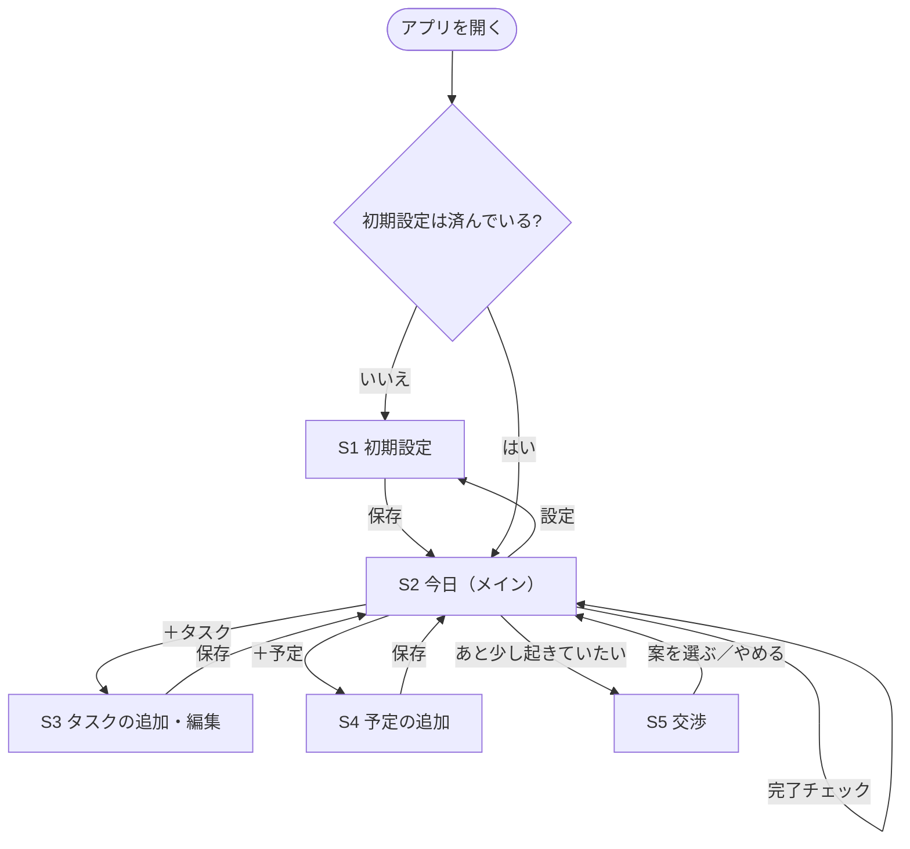
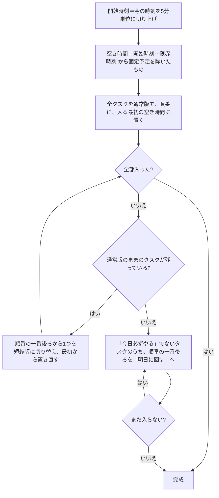
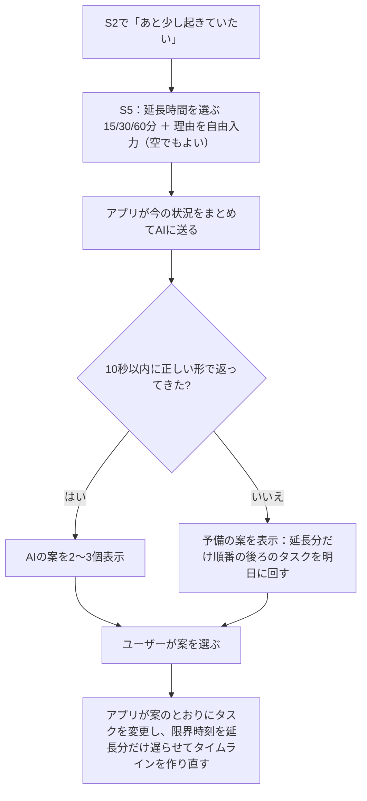
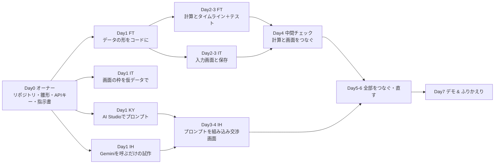

# Rism アルファ版 開発仕様書

- **版:** v1（2026-10-21）
- **共有範囲:** プロジェクトメンバー向け（特に開発メンバー）
- **元にした資料:** `project.md` 4.1、`feature_discussion.md` の案 A・B・E
- **読み方:** 開発責任者は 1・2・8・9 章、各担当は 3〜7 章のうち自分の担当部分を読んでください。
- 「**【仮決め】**」と書いた項目は、オーナー（ぷらぐら）が変えない限りこのまま進めてよい決め事です。「**開発者の判断でよい**」と書いた項目は、聞かずに決めて構いません。

---

## 1. アルファ版で確かめたいこと

> 「明日の授業と、今日やることを入れると、**何時までに作業を終えて寝ればいいか**が出て、その時刻に収まるように今日の予定が並ぶ。夜に『あと少し起きていたい』と言うと、**AI が何を削ればいいかを提案してくれる**。」

この一連の体験が、1 台のパソコンの Chrome 上で動けば成功です。見た目のきれいさは問いません。

### 1.1 完成の条件（デモで次の 7 つが動くこと）

| # | 操作 | 期待する結果 |
| --- | --- | --- |
| 1 | 初めて開く | 初期設定画面が出る |
| 2 | 時間割で「火曜 1 限」にチェックし、通学 30 分・準備 30 分・目標睡眠 7 時間で保存 | 月曜の夜に開くと、画面上部に「明日 1 限 → 起床 7:45 → 就寝 0:45 → 限界時刻 0:15」と出る（時刻は 3.1 の計算による） |
| 3 | タスクを 4 つ登録（課題・夕食・風呂・洗濯） | 今の時刻から限界時刻までの間に、タスクが並んだタイムラインが出る |
| 4 | 時間が足りない状態にする（タスクを増やす、または遅い時刻で試す） | 一部のタスクが「短縮版」になり、入りきらないものが「明日に回す」に移る |
| 5 | タスクの完了チェックを押す | 完了の表示になり、タイムラインが作り直される |
| 6 | 「あと少し起きていたい」→「30 分」を選ぶ | AI から 2〜3 個の案が出る |
| 7 | 案を 1 つ選ぶ | 選んだ案のとおりにタスクが短縮・明日送りされ、タイムラインと限界時刻が更新される |

### 1.2 アルファでやらないこと

ログイン、クラウド保存、通知、スマホ実機での動作、夜モード、翌朝の記録、課金、デザインの作り込み。
（通知は Web 版では使えないので、ベータで扱います）

---

## 2. 画面と流れ

### 2.1 画面一覧

| 画面 | 内容 |
| --- | --- |
| S1 初期設定 | 時間割、通学時間、朝の準備時間、目標睡眠時間、予定がない日の起床時刻 |
| S2 今日（メイン） | 上部に「明日の最初の予定 → 起床 → 就寝 → 限界時刻」、その下にタイムライン、「明日に回す」一覧、ボタン類 |
| S3 タスクの追加・編集 | 名前、通常の所要時間、短縮版の所要時間、「今日必ずやる」のチェック、定番タスクのボタン |
| S4 予定の追加 | 今日の固定予定（バイトなど）の名前・開始・終了 |
| S5 交渉 | 「あと少し起きていたい」から開く。延長時間と理由を入れ、AI の案から選ぶ |

### 2.2 画面の流れ



### 2.3 S2（メイン画面）の配置イメージ

```
┌──────────────────────────────┐
│ 明日 1限 9:00                        │
│ 起床 7:45 → 就寝 0:45                │
│ ★ 限界時刻 0:15（あと 4時間15分）    │
├──────────────────────────────┤
│ 20:00-21:30  課題          [ ] 完了  │
│ 21:30-22:15  夕食          [ ]       │
│ 22:15-22:30  風呂（短縮）  [ ]       │
│ 22:30-23:30  バイトの連絡（予定）    │
│ ...                                  │
├──────────────────────────────┤
│ 明日に回す：洗濯                     │
├──────────────────────────────┤
│ [＋タスク] [＋予定] [あと少し起きていたい] │
└──────────────────────────────┘
```

画面の細かな配置・色・文言は **UX/UI 担当と開発者の判断でよい**。

---

## 3. 機能の仕様

### 3.1 起床時刻と限界時刻の計算（案 A）

**入力（S1 で設定）**

| 項目 | 初期値【仮決め】 |
| --- | --- |
| 時間割（月〜金 × 1〜5 限のどこに授業があるか） | なし |
| 通学時間 | 30 分 |
| 朝の準備時間 | 30 分 |
| 目標の睡眠時間 | 7 時間 |
| 最低限の睡眠時間（AI の案でもこれより短くしない） | 6 時間 |
| 寝る準備の時間 | 30 分 |
| 予定がない日の起床時刻 | 8:00 |

**時限の開始時刻【仮決め・要確認】**（京大の時限。正しい時刻をメンバーに確認する）

| 1 限 | 2 限 | 3 限 | 4 限 | 5 限 |
| --- | --- | --- | --- | --- |
| 8:45 | 10:30 | 13:15 | 15:00 | 16:45 |

**計算**

```
明日の最初の予定 ＝ 明日の時間割の最初の授業 と 明日の固定予定 のうち早い方
起床時刻 ＝ 明日の最初の予定 − 通学時間 − 朝の準備時間
  （明日に予定がなければ「予定がない日の起床時刻」）
就寝時刻 ＝ 起床時刻 − 目標の睡眠時間
限界時刻 ＝ 就寝時刻 − 寝る準備の時間
```

**例：** 明日 1 限（8:45）→ 起床 7:45 → 就寝 0:45 → 限界時刻 0:15

**「今日」と「明日」の区切り【仮決め】：** 午前 4:00 で日付が変わるとみなす。たとえば深夜 1:00 に開いた場合は、まだ「前の日の夜」として扱い、「明日」はその日の朝のことになる。

**限界時刻をすでに過ぎている場合：** タイムラインは空にして、「限界時刻を過ぎています。今寝れば ○ 時間 ○ 分眠れます」と表示する。

### 3.2 タスク（案 B：短縮版つき）

| 項目 | 内容 |
| --- | --- |
| 名前 | 必須 |
| 通常の所要時間 | 必須。5 分単位 |
| 短縮版の所要時間 | 必須。0 分〜通常の時間。**0 分は「今日はやらなくてよい（明日に回せる）」の意味** |
| 今日必ずやる | チェックあり／なし。初期値はなし |
| 状態 | 未完了／完了／明日に回す |

**定番タスクのボタン【仮決め】**（押すと名前と時間が入る。保存前に変えてよい）

| タスク | 通常 | 短縮 |
| --- | --- | --- |
| 風呂 | 40 分 | 15 分 |
| 夕食 | 45 分 | 20 分 |
| 洗濯 | 15 分 | 0 分 |
| 洗い物 | 15 分 | 0 分 |
| 課題 | 90 分 | 45 分 |

### 3.3 固定予定

- 今日の固定予定（バイトなど）を S4 で入れる。名前・開始時刻・終了時刻。
- 時間割の授業は、アルファでは「明日の起床時刻の計算」にだけ使う。今日のタイムラインには授業を表示しなくてよい（**開発者の判断で表示してもよい**）。

### 3.4 タイムラインの作り方（いちばん大事なロジック）

**いつ作り直すか：** 画面を開いたとき、タスク・予定を追加・編集・完了したとき、交渉の案を選んだとき。

**並べる対象：** 未完了のタスク。並べる順番は「今日必ずやる」が先、その中は登録した順。

**手順**



**決まり**

- 1 つのタスクを途中で分けて置かない（アルファでは分割しない）。
- 限界時刻を越えて置かない。
- 短縮版が 0 分になったタスクは、置かずに「明日に回す」に入れる。
- 「今日必ずやる」タスクまで入らないときは、それらは置けた分だけ置き、入らなかったものを画面に「入りきりません」と赤字で出す（明日には回さない）。

**例 1（全部入る）：** 今 20:00、限界時刻 23:30、固定予定なし。

| タスク（順番） | 通常 | 短縮 | 結果 |
| --- | --- | --- | --- |
| 課題（今日必ず） | 90 | 45 | 20:00-21:30 |
| 夕食 | 45 | 20 | 21:30-22:15 |
| 風呂 | 40 | 15 | 22:15-22:55 |
| 洗濯 | 15 | 0 | 22:55-23:10 |

**例 2（足りない）：** 今 21:00、限界時刻 23:30（使える時間 150 分）。通常版の合計は 190 分で 40 分足りない。

1. 一番後ろの「洗濯」を短縮版（0 分）に → 合計 175 分。まだ足りない
2. 次の「風呂」を短縮版（15 分）に → 合計 150 分。入る

| タスク | 結果 |
| --- | --- |
| 課題 | 21:00-22:30 |
| 夕食 | 22:30-23:15 |
| 風呂（短縮） | 23:15-23:30 |
| 洗濯 | 明日に回す |

**テストについて：** このロジックは画面とは別の関数にして、上の例 1・例 2 を自動テスト（Dart の `test`）にすること。AI に「この 2 つの例をテストにして」と頼めば作れます。

### 3.5 完了チェック

- 押すと「完了」になり、タイムラインから外れて、画面下に「完了したタスク」として残る。
- もう一度押すと未完了に戻る。
- 完了したらタイムラインを作り直す（残りのタスクが今の時刻から並び直る）。

### 3.6 交渉：「あと少し起きていたい」（案 E・AI を使う）

**流れ**



**大事な設計の決め事**

- **AI には「どのタスクを短縮・明日送りにするか」だけを選ばせ、時刻の計算はアプリがする。** AI は時刻の計算を間違えることがあるため。
- AI の案の中に、必ず「今日は延長しない」案を 1 つ含める（アプリ側で常に追加してもよい）。
- 延長した結果、睡眠時間が「最低限の睡眠時間」を下回る案は、アプリ側で表示しない。延長時間の選択肢自体を減らしてもよい。
- 1 晩に延長できるのは合計 60 分まで【仮決め】。

**AI に送る内容（例）**

```json
{
  "now": "22:10",
  "limit_time": "23:30",
  "bedtime": "0:00",
  "wake_time": "7:30",
  "tomorrow_first": "1限 8:45",
  "target_sleep_min": 420,
  "min_sleep_min": 360,
  "extend_min": 30,
  "reason": "ドラマを最後まで見たい",
  "tasks": [
    {"id": "t1", "name": "課題", "normal_min": 90, "short_min": 45, "must_today": true,  "status": "pending"},
    {"id": "t2", "name": "風呂", "normal_min": 40, "short_min": 15, "must_today": false, "status": "pending"},
    {"id": "t3", "name": "洗濯", "normal_min": 15, "short_min": 0,  "must_today": false, "status": "pending"}
  ]
}
```

**AI に返してほしい形（JSON で返させる）**

```json
{
  "message": "30分延長すると睡眠は6時間30分になります。風呂をシャワーにすれば、延長しても今の就寝時刻を守れます。",
  "options": [
    {
      "title": "風呂をシャワーにして30分延長",
      "extend_min": 30,
      "changes": [{"task_id": "t2", "action": "shorten"}]
    },
    {
      "title": "洗濯を明日に回して15分だけ延長",
      "extend_min": 15,
      "changes": [{"task_id": "t3", "action": "postpone"}]
    },
    {
      "title": "今日は延長しない",
      "extend_min": 0,
      "changes": []
    }
  ]
}
```

- `action` は `shorten`（短縮版にする）か `postpone`（明日に回す）のどちらか。
- 返ってきた JSON の形が違う、知らない `task_id` がある、`extend_min` が選んだ延長時間を超える、といった場合は、その案を捨てる。全部捨てたら予備の案を出す。
- Gemini の「JSON で返す」設定（`responseMimeType: application/json` と回答の形の指定）を使うと、形が崩れにくい。

**AI の呼び出し方（アルファ）**

- Gemini API を、Dart の `http` パッケージで直接呼ぶ（REST API）。Dart 用の古い公式パッケージは今は勧められていないため。
- モデルは安い Flash 系【仮決め】。モデル名は 1 か所の設定で変えられるようにしておく。
- **API キーをコードに書かない・GitHub に上げない。** 実行時に `flutter run -d chrome --dart-define=GEMINI_API_KEY=...` で渡す。キーはオーナーから個別に受け取る。
- ベータでは、キーをアプリに置かない仕組み（Cloud Functions など）に移す。

**プロンプト（AI への指示文）の担当がやること**

- 上の入出力の形を前提に、指示文を作る。Google AI Studio で試せば、Flutter の準備は不要。
- 次のようなテストケースを 5 つ以上作り、毎回まともな案が返るか確かめる：
  - 時間に余裕があり、延長しても何も削らなくてよい
  - 延長すると「今日必ずやる」タスクに影響する（それは削らない案になるか）
  - 延長すると最低限の睡眠を下回る
  - 理由が空欄
  - タスクが 1 つもない
- 完成した指示文は、リポジトリの `docs/prompt_negotiation.md` に置く。アプリ担当はそれを読み込んで使う。

### 3.7 保存

- 設定・時間割・予定・タスクは、端末内（ブラウザの保存領域）に保存する。`shared_preferences` パッケージを使えば Web でも動く。
- データの持ち方は 4 章のとおり。JSON にして保存すればよい。

---

## 4. データの形

**時刻の持ち方【仮決め】：** 「その日の 0:00 からの分数」の整数で持つ。日付をまたぐ時刻は 1440 以上で表す（例：0:15 → 1455）。表示するときだけ「0:15」に直す。こうすると、日付をまたぐ計算で間違えにくい。

| データ | 項目 |
| --- | --- |
| 設定 Settings | 通学時間、朝の準備時間、目標睡眠、最低睡眠、寝る準備の時間、予定がない日の起床時刻 |
| 時間割 TimetableEntry | 曜日（1=月〜5=金）、時限（1〜5） |
| 固定予定 FixedEvent | id、名前、日付、開始、終了 |
| タスク Task | id、名前、通常の時間、短縮版の時間、今日必ずやる、状態（未完了／完了／明日に回す）、登録順、短縮版を使っているか |
| タイムラインの 1 行 TimelineItem | 種類（タスク／予定）、元の id、開始、終了、短縮版か |
| 交渉の記録 Negotiation | 日付、延長した分数（その晩の合計を超えないように使う） |

名前の付け方・ファイルの分け方は **開発者の判断でよい**。最初に担当者がこの表をコードにして、全員がそれを使う。

---

## 5. 技術の決め事

| 項目 | 内容 |
| --- | --- |
| 言語・フレームワーク | Flutter（Dart） |
| 動かす環境 | **Chrome（Web）**。`flutter run -d chrome` |
| 状態の管理 | 一番簡単な方法でよい（**開発者の判断でよい**）。迷ったら担当の AI ツールに「初心者向けに一番シンプルな方法で」と頼む |
| 画面の言語 | 日本語 |
| AI 向けの指示書 | リポジトリ直下に `CLAUDE.md`（Claude Code 用）と `AGENTS.md`（Codex 用）を置き、同じ内容にする。中身はこの仕様書の要点・ファイルの分け方・「API キーをコードに書かない」など |

### 5.1 Git の決め事

1. `main` に直接 push しない。作業ごとにブランチを作る（例：`it/input-screen`）。
2. できたら Pull Request を出し、誰か 1 人に見てもらってからまとめる（技術の相談役 FT が中心。手が空いている人でもよい）。
3. Pull Request は小さく。1 つの画面や 1 つの機能ごと。
4. API キーなどの秘密は絶対にコミットしない。
5. 困ったら、自分の AI ツールに「このエラーを初心者向けに説明して」と聞いてから、それでもだめなら LINE で相談。

---

## 6. 担当と作業の順番

### 6.1 担当【仮決め：開発責任者が調整してよい】

| 担当 | 内容 | 該当する章 |
| --- | --- | --- |
| FT | データの形（4 章）をコードにする、起床・限界時刻の計算（3.1）、タイムラインの作り方（3.4）とそのテスト | 3.1、3.4、4 |
| IT | S1 初期設定、S2 メイン、S3 タスク、S4 予定の画面。完了チェック（3.5）、保存（3.7） | 2、3.2、3.3、3.5、3.7 |
| IH | S5 交渉の画面、Gemini の呼び出し、返ってきた案のチェックと反映（3.6） | 3.6 |
| KY | 交渉用のプロンプトとテストケース（3.6 の最後） | 3.6 |

### 6.2 作業の順番



- **Day1 の最初に、FT がデータの形（4 章）を `main` に入れる。** 他の人はそれが入るまで、仮データで作業する。
- **計算（FT）と画面（IT）は、Day4 までは別々に作る。** 画面は仮のタイムラインを表示しておき、Day4 に本物の計算に差し替える。

---

## 7. 開発者の判断に任せること・迷ったときの原則

**任せること：** 画面の配置・色・ボタンの文言、ファイルの分け方、変数名、使うパッケージ（無料のもの）、状態管理の方法。

**迷ったときの原則（上から優先）**

1. **限界時刻は越えない。睡眠時間を削る提案はしない**（最低限の睡眠時間は絶対に守る）
2. 動くことを優先し、見た目は後回し
3. 仕様書に書いていない細かい部分は、自分で決めてよい。決めたことは Pull Request の説明に一言書く
4. 仕様の意図がわからないとき（何を作るか）→ オーナーに聞く。作り方がわからないとき → FT に聞く

---

## 8. 進め方（開発責任者向け）

### 8.1 タスクの管理

- GitHub の **Issues** に、下の作業を 1 つずつ登録し、担当者を割り当てる。
- GitHub の **Projects** で「未着手／作業中／完了」のボードを作ると、進み具合が一目でわかる（任意）。

**Issue にする作業の例**

| # | 作業 | 担当 |
| --- | --- | --- |
| 1 | データの形をコードにする（4 章） | FT |
| 2 | 起床・就寝・限界時刻の計算と表示（3.1） | FT |
| 3 | タイムラインの作成ロジックとテスト（3.4） | FT |
| 4 | S1 初期設定画面と保存 | IT |
| 5 | S2 メイン画面（仮データ表示） | IT |
| 6 | S3 タスク画面（定番ボタンつき） | IT |
| 7 | S4 予定画面 | IT |
| 8 | 完了チェック | IT |
| 9 | 交渉プロンプトとテストケース | KY |
| 10 | Gemini 呼び出しと返答のチェック | IH |
| 11 | S5 交渉画面と反映 | IH |
| 12 | 計算と画面をつなぐ | FT・IT |
| 13 | デモの 7 項目（1.1）を通しで確認 | 全員 |

### 8.2 毎日の報告

LINE グループで、作業した日だけでよいので 1 行ずつ。

```
【IT】やったこと：S1の画面 ／ 次やること：保存 ／ 困っていること：なし
```

### 8.3 中間チェック（Day4・15 分）

- 1.1 の完成の条件のうち、どこまで動いているかを確認する。
- 遅れていたら、**次の順番で削る**：
  1. S4 予定画面（固定予定なしでデモする）
  2. 定番タスクのボタン
  3. 交渉の理由の自由入力（延長時間のボタンだけにする）
  4. AI の呼び出し（予備の案だけで動かし、AI はプロンプト単体のデモにする）
- 1.1 の 1〜5（AI 以外）は削らない。

---

## 9. オーナー（ぷらぐら）がやること

| いつ | やること |
| --- | --- |
| 開始前（Day0） | アプリ用リポジトリと雛形（Flutter の空アプリ、`CLAUDE.md`・`AGENTS.md`、この仕様書）を用意する。Gemini の API キーを作り、予算アラートと利用制限を設定して開発メンバーに個別に渡す |
| 期間中 | 仕様（何を作るか）についての質問に、その日のうちに答える。【仮決め】を変えたいときは、早めに開発責任者に伝える |
| Day4・Day7 | 中間チェックとデモに参加する |

**オーナーがやらないこと：** 作り方・順番・担当の細かい調整（開発責任者に任せる）。

---

## 10. まだ決まっていないこと

| 項目 | 今の扱い | 決める人 |
| --- | --- | --- |
| 開発責任者（進行役） | 未定 | 開発メンバー |
| アルファ週の開始日とデモの日 | 未定 | 開発責任者 |
| 京大の時限の時刻 | 3.1 の【仮決め】 | 誰かが確認 |
| 1 晩の延長の上限 | 60 分【仮決め】 | オーナー |
| 最低限の睡眠時間 | 6 時間【仮決め】 | オーナー |
